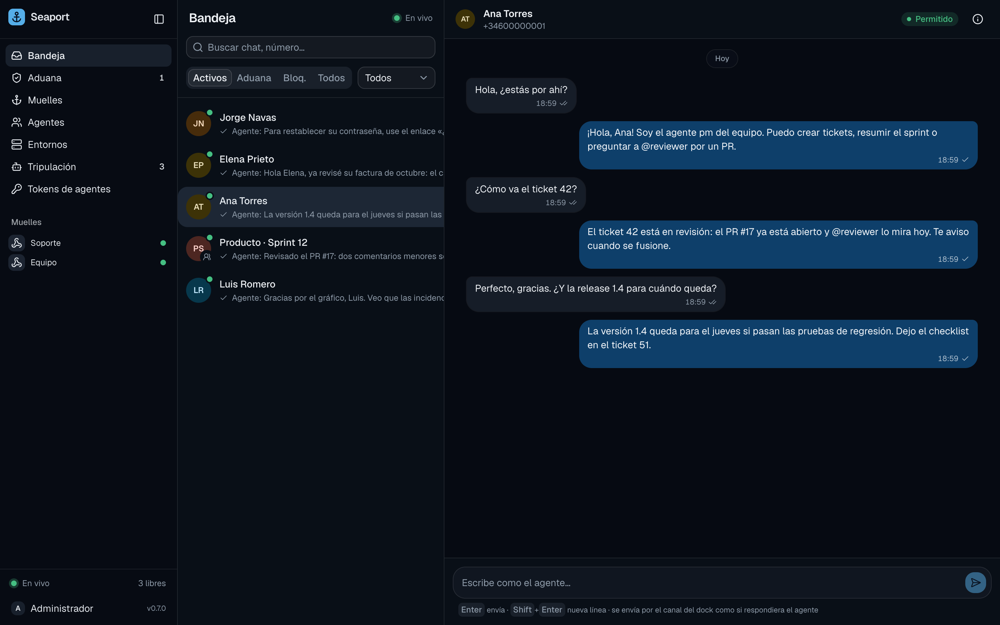

# Seaport documentation

Seaport is a port for AI agents: messages arrive at docks, customs decides who may wake an agent, and your agents answer with the port's tools.

These pages describe the current `main` branch, which tracks the latest [release](https://github.com/Abraxas-365/seaport/releases). Seaport is early-stage software: formats and APIs may still change. Read the [known limitations](project/known-limitations.md) before relying on it.

## Choose a path

| Goal | Start here |
| :--- | :--- |
| Install the binary | [Install Seaport](guides/installation.md) |
| Run a port on your computer and see a message arrive | [Your first port](tutorials/first-port.md) |
| Connect an agent and get a reply | [Your first agent](tutorials/first-agent.md) |
| Find your way around the web app (in Spanish) | [Web app tour](guides/web-app.md) |
| Understand docks, ships, customs and crew | [Concepts](explanation/concepts.md) |
| Put an agent behind a WhatsApp number | [WhatsApp docks](guides/whatsapp.md) |
| Feed messages from your own systems over HTTP | [api docks](guides/api-docks.md) |
| Decide who may wake an agent | [Customs](guides/customs.md) |
| Send and receive images | [Messages and images](guides/messages-and-images.md) |
| Run several agents and pick one with `@name` | [Agents and routing](guides/agents-and-routing.md) |
| Give an agent instructions, skills, MCP servers and secrets | [Agent profiles](guides/profiles.md) |
| Connect rness, Claude Code or any ACP agent | [The connector](guides/connector.md) |
| Let the port run the agent in a container | [Hosted agents](guides/hosting/hosted-agents.md) |
| Keep model keys out of containers and limit their network | [Model gateway and egress](guides/hosting/network.md) |
| Ship your own `~/.rness` or `~/.claude` to hosted agents | [Harness homes](guides/hosting/harness-homes.md) |
| Deploy on a server with HTTPS | [Deploy on one server](guides/operations/deploy.md) |
| Serve many organizations | [IAM mode](guides/operations/iam-mode.md) |
| Run several Seaport processes | [Several processes](guides/operations/several-processes.md) |
| Back up, restore and upgrade | [Backups and upgrades](guides/operations/backups-and-upgrades.md) |
| Look up a setting, command, route or limit | [Configuration](reference/configuration.md), [CLI](reference/cli.md), [HTTP API](reference/http-api.md), [Limits](reference/limits.md) |
| Know what is protected and how | [Security model](explanation/security-model.md) |
| Contribute | [Contributing](contributing/README.md), [Architecture](architecture.md) |

## How these docs are organized

- **Tutorials** walk you through a complete task with a concrete outcome.
- **Guides** show how to do one thing: link a number, write customs rules, host an agent.
- **Reference** lists every setting, command, route, event, field and limit.
- **Explanation** describes the concepts, the life of a message and the security model.
- **Project** and **Contributing** cover current limitations, the architecture and how to work on Seaport.

## A word on names

Seaport uses a port's vocabulary. The **port** is the server (`seaport serve`). A **dock** is a channel account where messages arrive: a WhatsApp number or an `api` dock. A **ship** is a message. **Customs** decides which chats may wake an agent. The **crew** is the set of connected agents, each run by a **harness** (rness, Claude Code) under `seaport connect` or in a hosted **slot**. See [Concepts](explanation/concepts.md).

The web app is in Spanish. These docs name each page in Spanish with the English meaning in parentheses: **Bandeja** (Inbox), **Aduana** (Customs), **Muelles** (Docks), **Agentes** (Agents), **Entornos** (Environments), **Tripulación** (Crew).

## Documentation scope

Examples use fictional numbers (`+34600000000`…), names and domains (`example.com`). Never put real phone numbers, tokens or keys in documentation, examples or issue reports: the repository is public. Engineering invariants live in [AGENTS.md](../AGENTS.md).
