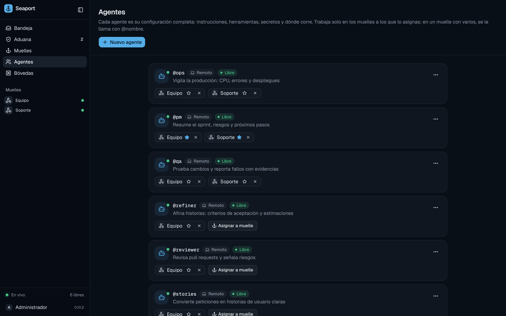

# Agents and routing

Agents are the workers behind your docks. This page covers the agent library, putting agents on docks, how Seaport picks the agent for each message, and the tokens agents connect with.

## The agent library

An **agent** is a named member of your organization's library: `pm`, `reviewer`, `support`. You create it once and then assign it to docks.

```sh
seaport agents add pm -description "Turns requests into tickets"
seaport agents                      # list: id, name, profile version, docks, description
seaport agents edit pm -name product-manager -description "…"
seaport agents clone pm pm-es -secrets   # a copy of its config, with its secrets
seaport agents delete pm -yes
```



| Property | Rule |
| :--- | :--- |
| Name | 1 to 32 lowercase letters, digits, `-` or `_`, starting with a letter or digit. Unique in the organization. |
| Description | optional, up to 1000 characters; shown to people choosing whom to call |
| Count | up to 100 agents per organization |

The name is also the agent's **`@mention` handle**: writing `@pm` in a message calls it. Renaming an agent changes the handle.

Deleting an agent revokes its tokens, closes its connections, and holds the messages that were waiting for it (reason `its agent left the dock`). The history of its conversations stays.

An agent also has a [profile](profiles.md): instructions, skills, MCP servers and secrets. The library entry only names it.

### Clone an agent

`seaport agents clone <agent> <name>` creates a new agent that starts as a copy of another's *current* [config](../reference/agent-config.md): the profile, the harness and the machine, saved as the clone's version 1. The name follows the rules above; the description is the source's unless you give `-description`. A [hosted](hosting/hosted-agents.md) agent's clone is hosted too, with the same number of slots, all stopped.

**Secrets** are copied only if you ask (`-secrets`; `secrets: true` in the API). Each one is re-encrypted for the clone on the server, keeping its `env` flag; no value is ever shown. Without it the clone is still created, but it has no secrets, so whatever needs one its config names (an MCP header's `${NAME}`, a repo credential, a model key) fails with an error naming the missing secret until you set it with `seaport agents secrets set <clone> NAME`. Starting a hosted clone's slot is refused for the same reason.

Never copied: docks and team membership, vault grants, crew tokens, browser takeovers, sessions, the browser profile and usage. Put the clone on a dock with `seaport agents assign`.

## Assign agents to docks

An agent works only on docks it is assigned to. The agents assigned to a dock are its **team**.

```sh
seaport agents assign pm <dock-id>
seaport agents assign support <dock-id> -default
seaport agents unassign pm <dock-id>
```

A team can have **one default** agent. Assigning an agent with `-default` makes it the default and demotes the previous one. In the web app, do the same from the dock's page (**Agentes** card) or from **Asignar a muelle** on an agent's row.

An agent can be on several docks, and a dock can have several agents. Unassigning an agent holds the messages that were waiting for it on that dock.

## What agents may read

An agent always gets the messages routed to it. Besides those, each dock has three switches, all on by default, for what the agents working it may read there:

| Switch | On | Off |
| :--- | :--- | :--- |
| `history` | The agent reads earlier messages with the `history` tool. | `history` on the dock's conversations is refused, and a `thread: true` read from another door skips them. The prompt tells the agent earlier messages are not available. |
| `conversations` | The dock's chats appear in the `conversations` tool. | They are left out of that list. |
| `attachments` | The agent sees the images and files people send (in its prompt and with the `attachment` tool). | The agent is told a file came, with its kind and name, but can't open it. |

The switches bind agents only: people read everything their role allows in the web app and the admin API. They apply wherever an agent reads (MCP tools, crew routes, the connector's prompt). When every dock of an agent has a switch off, its MCP server doesn't offer that tool at all.

```sh
seaport dock tools <dock-id>                         # shows them
seaport dock tools <dock-id> history off attachments off
```

In the web app, use the **Herramientas del agente** card on the dock's page. A WhatsApp dock on a personal number is a typical case: the agent answers the chats it is handed without reading the rest.

## Routing

Seaport picks the agent **once, when a message arrives** (after [customs](customs.md) lets it in). It goes through the dock's team in this order and stops at the first match:

1. **No team**: the message is held. Reason: `no agent is assigned to this dock`.
2. **A mention**: the first `@name` in the text that names a member of the team (any case). `user@pm` is an address, not a mention.
3. **The thread's previous agent**, if it is still on the team: the agent who last answered on this conversation or on one [linked](linked-conversations.md) with it. A chat keeps talking to whoever it was talking to.
4. **The only member**, if the team has one agent.
5. **The default** agent.
6. Otherwise the message is held. Reason: `no agent was called (mention one with @name)`.

A message routed to an agent is **queued** for it, and only that agent's connections can claim it. If the agent has no connection, the message waits, and so does the rest of that conversation, so messages are never handled out of order.

> [!NOTE]
> Routing is decided at arrival. When you **assign an agent** to the dock (a new member, or a member made the default), the dock's messages held for routing go through routing again with the new team: those held because the dock had no team, because nobody was called, or because their agent left. Only messages from the **last 24 hours** go, in **allowed** chats, and only those the chat hasn't moved past: a message older than the chat's last routed message or reply stays held, so a new team never answers out of order or late. Taking an agent off a dock releases nothing. You can read held messages in the web app, and the agent can read them with the `history` tool.

For a team with several agents, set a default if you want every unaddressed message to be handled. Without one, such messages are held until someone writes `@name`.

The held reasons are listed in [Message lifecycle](../explanation/message-lifecycle.md#held-reasons).

## Crew tokens

An agent connects to the port with a **crew token**. Each token belongs to one agent, and a connection that uses it works as that agent: it receives only that agent's messages, and its MCP calls act only on that agent's docks.

```sh
seaport crew tokens create laptop -agent pm                # never expires
seaport crew tokens create ci -agent pm -expires 720h
seaport crew tokens list                                   # never shows values
seaport crew tokens revoke <token-id>
```

The value starts with `sp_crew_` and is **shown once**, when you create the token. Seaport stores only its SHA-256 and the first characters, so you can tell tokens apart. Copy it right away.

| Rule | Value |
| :--- | :--- |
| One agent per token | required |
| Lifetime | none, or a duration up to 5 years |
| Active tokens | up to 100 per organization |
| Revoking | closes the token's live connections, on every process |

In the web app: **Tokens de agentes** → **Nuevo token** (agent, name, lifetime), then **Revocar** on a row. Create **one token per machine** so you can revoke them separately.

A port in `none` mode has no tokens: the connector names its agent with `-agent pm` instead. A port in `token` or `iam` mode refuses connections without a token. The old shared `SEAPORT_CREW_TOKEN` setting on the *server* is ignored (the port logs a warning); only the connector reads that variable.

## Several connections per agent

You can connect the same agent from several machines, or several times from one. Each connection is shown separately under the agent's name in **Tripulación** and in `seaport crew`.

- Every connection can claim the agent's messages, so the work is shared.
- One conversation is handled by one connection at a time, in arrival order.
- Each connection has its own **concurrency**: how many conversations it works on at once (`-concurrency`, see [The connector](connector.md)).
- The organization has a limit on live connections (`SEAPORT_MAX_CREW_CONNECTIONS`, 20 by default). Beyond it, new connections are refused.

> [!TIP]
> A harness session remembers the conversation. The connector saves its sessions on its own machine, so a conversation that moves to another machine starts a fresh session there. The agent still has the `history` tool.

## CLI summary

| Command | Does |
| :--- | :--- |
| `seaport agents add <name> [-description D]` | creates an agent |
| `seaport agents clone <agent> <name> [-secrets] [-description D]` | copies its config (and, with `-secrets`, its secrets) into a new agent |
| `seaport agents edit <agent> [-name N] [-description D]` | renames or describes it |
| `seaport agents delete <agent> -yes` | deletes it |
| `seaport agents assign <agent> <dock-id> [-default]` | puts it on a dock, optionally as default |
| `seaport agents unassign <agent> <dock-id>` | takes it off a dock |
| `seaport agents profile …`, `seaport agents secrets …` | [profiles](profiles.md) |
| `seaport crew` | shows connected agents and what they are working on |
| `seaport crew tokens [list]` | lists tokens (never their values) |
| `seaport crew tokens create <name> -agent <agent> [-expires D]` | creates a token |
| `seaport crew tokens revoke <token-id>` | revokes a token |

Next: [Agent profiles](profiles.md), [The connector](connector.md). Full flags are in the [CLI reference](../reference/cli.md).
