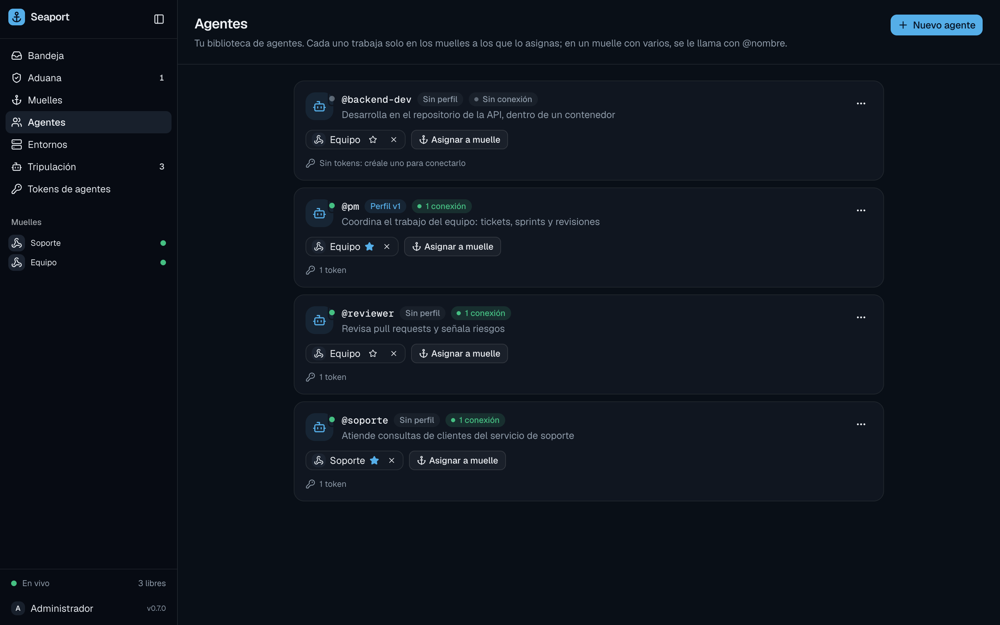

# Agents and routing

Agents are the workers behind your docks. This page covers the agent library, putting agents on docks, how Seaport picks the agent for each message, and the tokens agents connect with.

## The agent library

An **agent** is a named member of your organization's library: `pm`, `reviewer`, `support`. You create it once and then assign it to docks.

```sh
seaport agents add pm -description "Turns requests into tickets"
seaport agents                      # list: id, name, profile version, docks, description
seaport agents edit pm -name product-manager -description "…"
seaport agents delete pm -yes
```



| Property | Rule |
| :--- | :--- |
| Name | 1 to 32 lowercase letters, digits, `-` or `_`, starting with a letter or digit. Unique in the organization. |
| Description | optional, up to 1000 characters; shown to people choosing whom to call |
| Count | up to 100 agents per organization |

The name is also the agent's **`@mention` handle**: writing `@pm` in a message calls it. Renaming an agent changes the handle.

Deleting an agent revokes its tokens, closes its connections, and holds the messages that were waiting for it (reason `its agent left the dock`). The history of its conversations stays.

An agent also has a [profile](profiles.md): instructions, skills, MCP servers and secrets. The library entry only names it.

## Assign agents to docks

An agent works only on docks it is assigned to. The agents assigned to a dock are its **team**.

```sh
seaport agents assign pm <dock-id>
seaport agents assign support <dock-id> -default
seaport agents unassign pm <dock-id>
```

A team can have **one default** agent. Assigning an agent with `-default` makes it the default and demotes the previous one. In the web app, do the same from the dock's page (**Agentes** card) or from **Asignar a muelle** on an agent's row.

An agent can be on several docks, and a dock can have several agents. Unassigning an agent holds the messages that were waiting for it on that dock.

## Routing

Seaport picks the agent **once, when a message arrives** (after [customs](customs.md) lets it in). It goes through the dock's team in this order and stops at the first match:

1. **No team**: the message is held. Reason: `no agent is assigned to this dock`.
2. **A mention**: the first `@name` in the text that names a member of the team (any case). `user@pm` is an address, not a mention.
3. **The conversation's previous agent**, if it is still on the team. A chat keeps talking to whoever it was talking to.
4. **The only member**, if the team has one agent.
5. **The default** agent.
6. Otherwise the message is held. Reason: `no agent was called (mention one with @name)`.

A message routed to an agent is **queued** for it, and only that agent's connections can claim it. If the agent has no connection, the message waits, and so does the rest of that conversation, so messages are never handled out of order.

> [!NOTE]
> Routing is decided at arrival and not revisited. A message held because the dock had no team, or because nobody was called, stays held after you assign an agent or set a default. Only new messages use the new team. You can read held messages in the web app, and the agent can read them with the `history` tool.

For a team with several agents, set a default if you want every unaddressed message to be handled. Without one, such messages are held until someone writes `@name`.

The held reasons are listed in [Message lifecycle](../explanation/message-lifecycle.md#held-reasons).

## Crew tokens

An agent connects to the port with a **crew token**. Each token belongs to one agent, and a connection that uses it works as that agent: it receives only that agent's messages, and its MCP calls act only on that agent's docks.

```sh
seaport crew tokens create laptop -agent pm                # never expires
seaport crew tokens create ci -agent pm -expires 720h
seaport crew tokens list                                   # never shows values
seaport crew tokens revoke <token-id>
```

The value starts with `sp_crew_` and is **shown once**, when you create the token. Seaport stores only its SHA-256 and the first characters, so you can tell tokens apart. Copy it right away.

| Rule | Value |
| :--- | :--- |
| One agent per token | required |
| Lifetime | none, or a duration up to 5 years |
| Active tokens | up to 100 per organization |
| Revoking | closes the token's live connections, on every process |

In the web app: **Tokens de agentes** → **Nuevo token** (agent, name, lifetime), then **Revocar** on a row. Create **one token per machine** so you can revoke them separately.

A port in `none` mode has no tokens: the connector names its agent with `-agent pm` instead. A port in `token` or `iam` mode refuses connections without a token. The old shared `SEAPORT_CREW_TOKEN` setting on the *server* is ignored (the port logs a warning); only the connector reads that variable.

## Several connections per agent

You can connect the same agent from several machines, or several times from one. Each connection is shown separately under the agent's name in **Tripulación** and in `seaport crew`.

- Every connection can claim the agent's messages, so the work is shared.
- One conversation is handled by one connection at a time, in arrival order.
- Each connection has its own **concurrency**: how many conversations it works on at once (`-concurrency`, see [The connector](connector.md)).
- The organization has a limit on live connections (`SEAPORT_MAX_CREW_CONNECTIONS`, 20 by default). Beyond it, new connections are refused.

> [!TIP]
> A harness session remembers the conversation. The connector saves its sessions on its own machine, so a conversation that moves to another machine starts a fresh session there. The agent still has the `history` tool.

## CLI summary

| Command | Does |
| :--- | :--- |
| `seaport agents add <name> [-description D]` | creates an agent |
| `seaport agents edit <agent> [-name N] [-description D]` | renames or describes it |
| `seaport agents delete <agent> -yes` | deletes it |
| `seaport agents assign <agent> <dock-id> [-default]` | puts it on a dock, optionally as default |
| `seaport agents unassign <agent> <dock-id>` | takes it off a dock |
| `seaport agents profile …`, `seaport agents secrets …` | [profiles](profiles.md) |
| `seaport crew` | shows connected agents and what they are working on |
| `seaport crew tokens [list]` | lists tokens (never their values) |
| `seaport crew tokens create <name> -agent <agent> [-expires D]` | creates a token |
| `seaport crew tokens revoke <token-id>` | revokes a token |

Next: [Agent profiles](profiles.md), [The connector](connector.md). Full flags are in the [CLI reference](../reference/cli.md).
