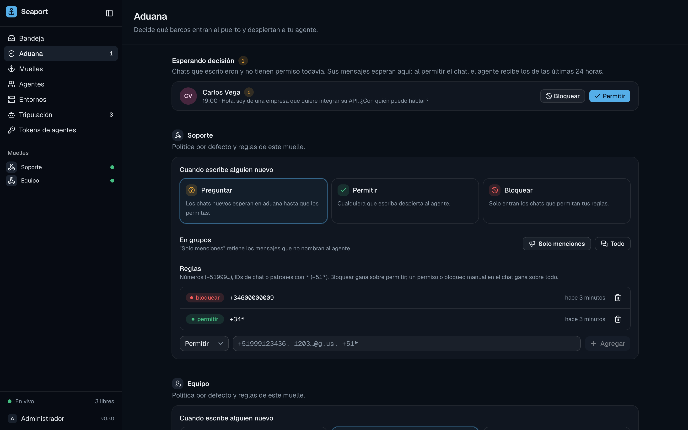

# Customs

Customs decides which chats may wake an agent. Anyone can write to a WhatsApp number; customs keeps strangers, spam and noisy groups away from your agents, while every message is still stored and visible to you.

Each dock has its own customs: a **default** for chats nothing else covers, a **group mode**, and **rules**. You can also decide one conversation by hand (an **override**).



## The default

| Default | A new chat is | Use it when |
| :--- | :--- | :--- |
| `ask` (initial) | **pending**: its messages wait until you allow or deny it | a public number; you review who gets in |
| `allow` | **allowed** | an `api` dock fed only by your systems; a number only known to your team |
| `deny` | **denied** | only chats you allow by rule or by hand may get in |

```sh
seaport customs -dock <dock-id>                 # policy and rules (-dock is optional with one dock)
seaport customs -dock <dock-id> default ask|allow|deny
```

Pending chats appear in the web app under **Aduana** (Customs) with a badge in the sidebar, and in `seaport conversations -pending`.

## Rules

A rule allows or denies chats and senders whose **handles** match a pattern. Handles are what the channel reports:

| Channel | Handles |
| :--- | :--- |
| WhatsApp | phone numbers as `+<digits>` (`+34600000001`), user ids (`…@s.whatsapp.net`, `…@lid`), groups (`…@g.us`) |
| `api` dock | `chat_handles` and `sender_handles` you post, else `chat_id` and `sender_id` |

`*` matches any run of characters; everything else is literal and case-insensitive. Phone patterns are normalized: `34 600-000-001` and `34600*` become `+34600000001` and `+34600*`.

```sh
seaport customs allow "+34*"             # Spanish numbers may wake the agent
seaport customs deny +34600000009        # never this one, not even inside groups
seaport customs allow 120363…@g.us       # this group (mentions only by default)
seaport customs rm <rule-id>
```

A dock has at most 1000 rules. A `*` rule alone is refused: use the default instead.

## The order of decisions

A chat's status is decided in this order; the first match wins:

1. **Your override** on the conversation (`seaport allow|deny <conversation-id>`).
2. **Your own chat** ("message yourself" on WhatsApp) is always allowed.
3. **Deny rules** matching the chat's handles.
4. **Allow rules** matching the chat's handles.
5. **The dock's default** (`ask` → pending).

The status is stored and decided again on every arrival and whenever a rule, the default or an override changes, so adding a rule re-decides existing chats at once.

`seaport auto <conversation-id>` removes your override: the chat follows the rules again.

## Groups

In an allowed group, the **group mode** decides which messages wake an agent:

| Mode | Wakes the agent |
| :--- | :--- |
| `mentions` (initial) | messages that @mention the number or reply to one of its messages |
| `all` | every message |

```sh
seaport customs groups mentions|all            # the dock's mode
seaport mode <conversation-id> all             # this group only (mentions|all|default)
```

A deny rule matching a **sender** also holds that sender's messages in allowed groups, unless you allowed the group itself by hand.

## Messages that wait

Messages that don't pass are never dropped. They are stored **held**, with a reason the web app shows on the message:

| Reason | Meaning |
| :--- | :--- |
| `conversation pending` | the chat waits for your decision |
| `conversation denied` | the chat is denied |
| `sender denied by a rule` | a deny rule matches the sender (groups) |
| `group message without a mention` | a group in `mentions` mode, not addressed to you |

When a pending **direct** chat becomes allowed (by you, a rule or the default), what it sent while it waited goes to the agent, oldest first: messages of the last 24 hours, the newest 50 at most. Older messages, a denied chat's messages and a group's held messages stay held; the agent can still read them with the `history` tool.

Routing can hold messages too (no agent on the dock, or nobody called); see [Agents and routing](agents-and-routing.md#routing).

## In the web app

- **Aduana** (Customs): the pending chats of every dock, to allow or deny in one click.
- A conversation's side panel (**Aduana** section): the override and the group mode.
- A dock's page → **Aduana**: the default, group mode and rules.

## Who may change customs

Agents can't: the MCP tools have no customs operation, and replies are only accepted in allowed conversations. In iam mode, changing customs needs `seaport:customs:write`, and allowing or denying a conversation needs `seaport:conversations:write`; see [Permissions](../reference/permissions.md).
