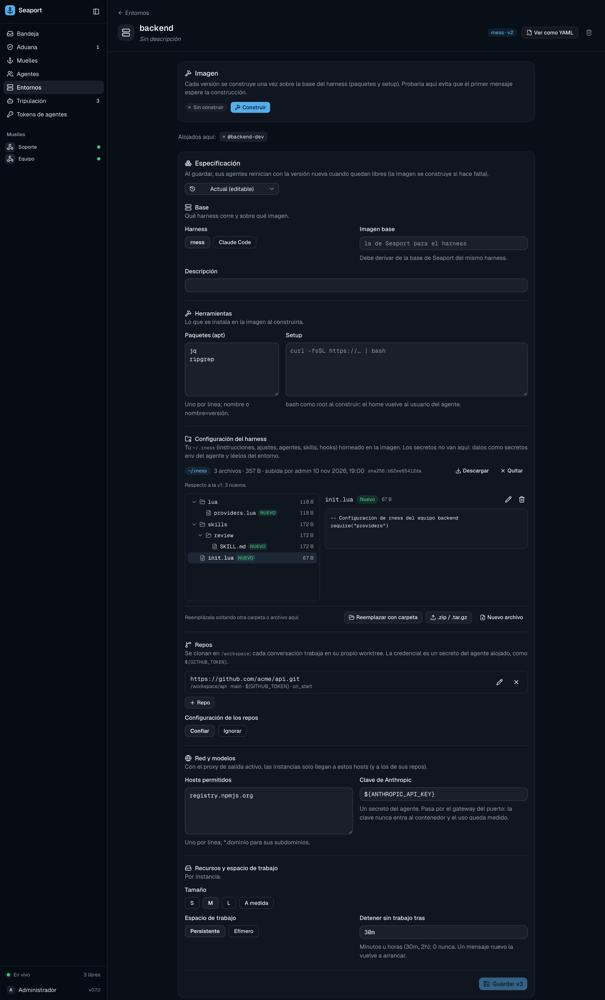

# Bring your own harness config

Upload your `~/.claude` or `~/.rness` so hosted agents run with your instructions, settings, skills and hooks.

A hosted agent starts from a clean image, so it doesn't know how you like to work. A **harness home** is the configuration you already have on your machine, uploaded once and baked into the environment's image. Every slot of that environment then starts with it.

## What goes in

Only configuration is accepted. Sessions, history, sign-in, memory, caches and installed plugins are never uploaded.

| Harness | Home | Allowed paths |
| :--- | :--- | :--- |
| `claude-code` | `~/.claude` | `CLAUDE.md`, `settings.json`, `keybindings.json`, `statusline*` files, and the directories `agents/`, `commands/`, `skills/`, `hooks/`, `output-styles/` |
| `rness` | `~/.rness` | `init.lua`, `hooks.json`, and the directories `lua/`, `plugins/`, `skills/` |

Rules for every upload:

- Regular files only.
- Up to 2000 files, 5 MiB per file, 20 MiB in total, paths up to 255 characters and 12 directories deep. One upload is at most 25 MiB.
- `lua/seaport.lua` is reserved: Seaport owns it (it routes rness through the port's gateway).
- A file that looks like a credential is refused.

### Secret scanning

A home is baked into an image and readable by anyone with `environments:read`, so it must not hold secrets. Seaport refuses text files containing strings with the shape of:

- Anthropic, OpenAI, Google, GitHub, GitLab and Slack tokens,
- AWS access keys,
- private keys (`-----BEGIN … PRIVATE KEY-----`),
- Seaport crew tokens and IAMKit API keys.

The error names the file and line. Give the secret to the agent instead (`seaport agents secrets set <agent> NAME -env`) and read it from the environment in your config.

## Upload it

### From the CLI

```sh
seaport env home push backend              # ~/.rness or ~/.claude, by the environment's harness
seaport env home push backend ~/dotfiles/claude
seaport env home push backend -dry-run     # list what would go in, upload nothing
```

`push` follows symlinks (dotfiles often link skills in), leaves out everything that isn't an allowed path and lists what it skipped. It uploads the home and saves a new version of the environment that names it.

Read it back with:

```sh
seaport env home show backend              # files, sizes and who uploaded it
seaport env home pull backend ./home-copy  # download into a new or empty directory
```

### In the spec

`home:` also takes a directory, relative to the spec file. `seaport env apply` uploads it first:

```yaml
name: backend
harness: rness
home: ./rness-home
```

After the upload, the saved spec names the home by its digest (`home: sha256:…`).

### From the web app

On an environment's page, the **Configuración del harness** section takes a dropped folder (a home directory holding `.claude/` works), a `.zip` or a `.tar.gz`. The browser checks the files with the server's own rules, shows what goes in and what it left out, and uploads. You can open, edit and delete files, and compare them with the previous version before saving. Edits re-upload the whole home.



## The digest

Seaport normalizes a home before storing it: sorted files, fixed owner (uid and gid 1000), fixed permissions and no timestamps. The digest is a SHA-256 of the harness and that archive, so the same files always give the same digest, and re-uploading an unchanged home changes nothing (an unchanged spec makes no version).

The archive is stored sealed in the blob store, which needs a secret key. Without one (or without a blob store), uploads are refused. Homes that no environment version names are deleted after a day, and a port keeps up to 500.

## How it is applied

**At build.** The image copies your home over `/home/agent`, after your `setup` script, then runs a finishing step:

- **rness:** keeps `require("seaport")` as the first line of `init.lua`.
- **Claude Code:** adds the marketplaces that `settings.json` declares under `extraKnownMarketplaces` (GitHub or HTTPS git sources only; a local directory is refused), and installs the plugins that `enabledPlugins` turns on. Plugins from Anthropic's official marketplace need no declaration. A plugin that fails to install fails the build, and the build needs network access to those hosts.

**At start.** The slot seeds its state volume from the image: changed files are replaced, and files your previous home had and the new one doesn't are deleted. What the harness wrote itself (sessions, sign-in, memory) is left alone.

> [!WARNING]
> An uploaded file replaces the base image's file of the same name entirely. If you upload an rness `init.lua`, it must still load the providers (`require("providers")`), or the slot fails with `unknown provider 'anthropic'`.

## Next

- [Run agents on the port](hosted-agents.md)
- [Network](network.md): the hosts a plugin build or install needs.
- [Environment spec](../../reference/environment-spec.md)
