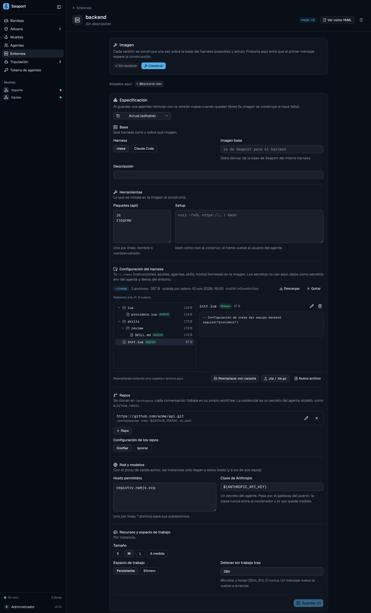

# Run agents on the port

Let the port run your agents in Docker containers, started when messages arrive and stopped when work runs out, so nobody has to keep a `seaport connect` open.

Without hosting, an agent runs wherever you run `seaport connect`: your laptop, a server you manage. That is fine for one person. When a team shares a port, or an agent should answer at 3 a.m., you want the port itself to start the agent, give it the repos and tools it needs, and stop it when it is idle. That is hosting.

Three words to keep apart:

- An **environment** says where an agent runs: harness, image, packages, repos, network, resources. It is versioned.
- **Hosting** an agent on an environment gives it **slots**.
- A **slot** is one container, named `<agent>-<n>` (`pm-1`, `pm-2`). Each slot keeps its own sessions and workspace.

## Requirements

- `SEAPORT_RUNTIME=docker` on the port. The default, `off`, refuses builds and starts.
- `SEAPORT_AUTH=token` or `iam`. Slots sign in with crew tokens, so `none` mode is refused at start.
- A Docker engine the port can reach, at `DOCKER_HOST`.

The [`deploy/`](../operations/deploy.md) compose file wires all of this. Set `SEAPORT_RUNTIME=docker` in `deploy/.env`, then start it with the `hosting` profile:

```sh
docker compose --profile hosting up -d --build
```

The profile adds a `docker-proxy` service (a Docker socket proxy that allows only the Engine calls Seaport makes: containers, exec, images, build, volumes, networks). The Docker socket is never mounted into Seaport. Slots run on the `internal` network `seaport-slots`, where the only thing they reach is Seaport.

> [!WARNING]
> Whoever controls Seaport controls that Docker engine. Give hosting a server or VM of its own.

The deploy compose file sets `SEAPORT_RUNTIME_NETWORK`, `SEAPORT_AGENT_URL` and `SEAPORT_EGRESS_ADDR` for you. Other hosting variables:

| Variable | Default | Meaning |
| :--- | :--- | :--- |
| `SEAPORT_AGENT_URL` | `SEAPORT_PUBLIC_URL` | How slots reach the port, such as `http://seaport:8740` on a shared Docker network. |
| `SEAPORT_RUNTIME_NETWORK` | `bridge` | The Docker network slots join. Make it `internal` when you use the egress proxy. |
| `SEAPORT_RUNTIME_HOST_GATEWAY` | `true` | Adds `host.docker.internal` to slots, so they can reach a port running on the host. |
| `SEAPORT_IMAGE_RNESS`, `SEAPORT_IMAGE_CLAUDE_CODE` | the release's image | Base images, see [Image builds](#image-builds). |
| `SEAPORT_MAX_SLOTS` | `10` | Slots per organization. `0` turns the limit off. |
| `SEAPORT_HOST_MAX_CPUS`, `SEAPORT_HOST_MAX_MEMORY_MB` | `4`, `8192` | The most one slot may ask for. `0` turns a limit off. |

The full list, with the network variables, is in [Configuration](../../reference/configuration.md).

## Environments

An environment is a YAML spec. This one runs rness with two apt packages, one repo and a model key:

```yaml
name: backend
harness: rness              # rness | claude-code
packages: [jq, ripgrep]     # apt, into a derived image
setup: |                    # bash as root at build time, never secrets
  npm i -g pnpm
repos:
  - url: https://github.com/acme/api.git
    ref: main
    credential: ${GITHUB_TOKEN}   # a secret of the hosted agent
    on_start: pnpm i
repo_config: trust          # ignore: the harness skips the repos' own configuration
home: ./rness-home          # your harness config, see "Harness homes"
models:
  anthropic: ${ANTHROPIC_API_KEY}
network:
  egress: [registry.npmjs.org]
resources: {size: M}
workspace: persistent
idle_stop: 30m
```

Fields, with their limits:

| Field | Meaning |
| :--- | :--- |
| `name` | Lowercase letters, digits, `-` and `_`, starting with a letter or digit, up to 64 characters. |
| `description` | Up to 1000 characters. |
| `harness` | `rness` or `claude-code`. |
| `image` | Your own base image. It must derive from Seaport's base image of the same harness. |
| `packages` | Up to 100 apt packages, optionally pinned as `name=version`. |
| `setup` | A bash script run as root at build time, up to 16384 bytes. It is stored and baked into the image: no secrets. |
| `repos` | Up to 10 repos: `url` (https), `ref`, `path` (under `/workspace`), `credential`, `on_start`. |
| `repo_config` | `trust` (default): the harness reads the repos' `AGENTS.md`, `CLAUDE.md`, `.claude/` and `.rness/`. `ignore`: it doesn't. |
| `home` | A harness home, see [Harness homes](harness-homes.md). |
| `models.anthropic` | The secret holding the model key, see [Network](network.md). |
| `network.egress` | Up to 100 allowed hosts, see [Network](network.md). |
| `resources` | `size: S`, `M` or `L`, or `cpus` and `memory_mb`. |
| `workspace` | `persistent` (default) or `ephemeral`. |
| `idle_stop` | Idle time before a slot stops. |

A spec can't hold secrets. `credential` and `models.anthropic` name a secret of the hosted agent as `${NAME}`, and Seaport checks the secret exists when you host the agent and each time you save the spec. Naming credentials needs `agents:write` as well as `environments:write` (see [Permissions](../../reference/permissions.md)). Unknown keys are rejected by `seaport env apply`. The full schema is in [Environment spec](../../reference/environment-spec.md).

Environments are versioned like agent profiles: each change makes a new version, and a file identical to the current one makes none. A port keeps up to 50 environments.

### From the CLI

```sh
seaport env apply -f env.yaml        # create it, or save a new version (- reads stdin)
seaport env                          # list
seaport env versions backend
seaport env export backend -version 2   # print a version as YAML
seaport env delete backend -yes      # only when no agent runs on it
```

### From the web app

Open **Entornos** and pick an environment. The page follows the spec: **Base**, **Herramientas** (packages and setup), **Configuración del harness**, **Repos**, **Red y modelos**, and **Recursos y espacio de trabajo**. A selector at the top switches between saved versions; the current one is editable.



Saving makes a new version. Agents running on the environment move to it once they are idle, and the image is built if it isn't yet.

## Image builds

Each environment version is built once into a Docker image. The image starts `FROM` Seaport's base image for the harness, installs your apt packages, runs your `setup` script as root, then copies your harness home over `/home/agent`.

| Harness | Base image |
| :--- | :--- |
| `rness` | `ghcr.io/abraxas-365/seaport-rness` |
| `claude-code` | `ghcr.io/abraxas-365/seaport-claude-code` |

The tag is the release's version, or `latest` for a build that isn't a release. Point `SEAPORT_IMAGE_RNESS` or `SEAPORT_IMAGE_CLAUDE_CODE` at another image to override it.

A custom `image:` must derive from one of these. The base images carry the labels `io.seaport.base` and `io.seaport.harness`, a derived image inherits them, and Seaport refuses an image without both (the harness label must match the spec's). Install tools as root, then return to user `1000:1000`.

Built images are named `seaport-env-<environment>:v<N>-<hash>`, where the hash covers the harness, base image, generated Dockerfile and setup script. A changed base, spec or home therefore makes a new image, and an unchanged one is reused. They are labeled with `io.seaport.organization`, `io.seaport.environment` and `io.seaport.version`.

Build ahead of time so the first message doesn't wait for it:

```sh
seaport env build backend             # follows the build log
seaport env build backend -version 2
seaport env build backend -force      # build again and pull the base anew (a moving tag such as latest)
seaport env build backend -wait=false # start it and return
```

A build that stops reporting for a minute is treated as dead, and the next caller may start it again.

## Host an agent

Create the secrets the environment names, then host the agent:

```sh
printf %s "$GITHUB_TOKEN" | seaport agents secrets set pm GITHUB_TOKEN
printf %s "$ANTHROPIC_API_KEY" | seaport agents secrets set pm ANTHROPIC_API_KEY
seaport agents host pm backend -slots 2
seaport agents slots pm
```

`-slots` defaults to 1. An agent can't be hosted on an environment whose secrets it lacks, and a secret an environment uses can't be deleted.

On the web, the agent's page has an **Alojamiento** section with one row per slot: state, **Arrancar** and **Detener** buttons, **Registro** for the container's output, and **Conectar cuenta** for [Claude subscriptions](claude-subscriptions.md).

### Slot states

A slot moves through these states:

```text
stopped → starting → running → stopping → stopped
                 ↘ failed
```

```sh
seaport agents start pm-1        # slot 1 when you give just "pm"
seaport agents stop pm-1
seaport agents logs pm-1 -lines 500   # last lines, up to 2000 (default 300)
seaport agents unhost pm              # stop its slots first
```

Starting builds the environment's image if needed, mints a crew token for this run (the slot signs in with it, and it is revoked when the slot stops), and runs the container. A slot that fails to start shows why in `seaport agents slots`.

### The supervisor

You rarely start slots by hand. Every Seaport process runs a supervisor that checks every 15 seconds and when new work is queued:

- **Wakes** a hosted agent that has queued ships and no slot up. It starts the lowest stopped slot, or a failed one after 5 minutes, one at a time per agent.
- **Stops** a running slot that has been idle longer than `idle_stop`.
- **Restarts** an idle slot whose environment has a newer version.
- **Fails** a running slot whose container is gone or exited.
- **Cleans up** starts and stops that stalled, and containers that no slot row owns.

`idle_stop` takes whole minutes or hours between `1m` and `168h` (`30m`, `2h`). `0` or `never` keeps slots running. The default is `30m`. The next message wakes the agent again, and its conversations resume from the state volume.

## Workspace and repos

Repos are cloned into `/workspace` when a slot starts. If the workspace is persistent and the repo is already there, Seaport fetches instead and leaves your agent's work untouched. A failed `on_start` is logged and the start goes on.

Each conversation gets its own git worktree, on a branch named `seaport/<conversation>`. Two conversations worked at once don't edit one tree. Without repos, every conversation works in `/workspace` itself.

Git gets credentials from the port each time it asks: inside the slot, git's credential helper calls the port with the slot's token, and the port answers with the secret named by `credential`. No token is written to disk.

`workspace: persistent` keeps `/workspace` in a per-slot volume across restarts. `ephemeral` starts every run clean. The harness's sessions and sign-in live in a separate state volume, so a woken slot resumes its conversations either way.

## Resources

Resources apply to each slot, not to the agent:

| Size | CPUs | Memory |
| :--- | :--- | :--- |
| `S` (default) | 1 | 2048 MB |
| `M` | 2 | 4096 MB |
| `L` | 4 | 8192 MB |

For something else, give `cpus` (0.25 to 64) and `memory_mb` (256 to 262144) instead of `size`. Don't combine them. Both are capped by `SEAPORT_HOST_MAX_CPUS` and `SEAPORT_HOST_MAX_MEMORY_MB`, and the port runs at most `SEAPORT_MAX_SLOTS` slots per organization.

## Next

- [Network](network.md): the model gateway and the egress proxy.
- [Harness homes](harness-homes.md): bring your own `~/.claude` or `~/.rness`.
- [Claude subscriptions](claude-subscriptions.md): sign slots in without an API key.
- [Security model](../../explanation/security-model.md): how slots are hardened.
