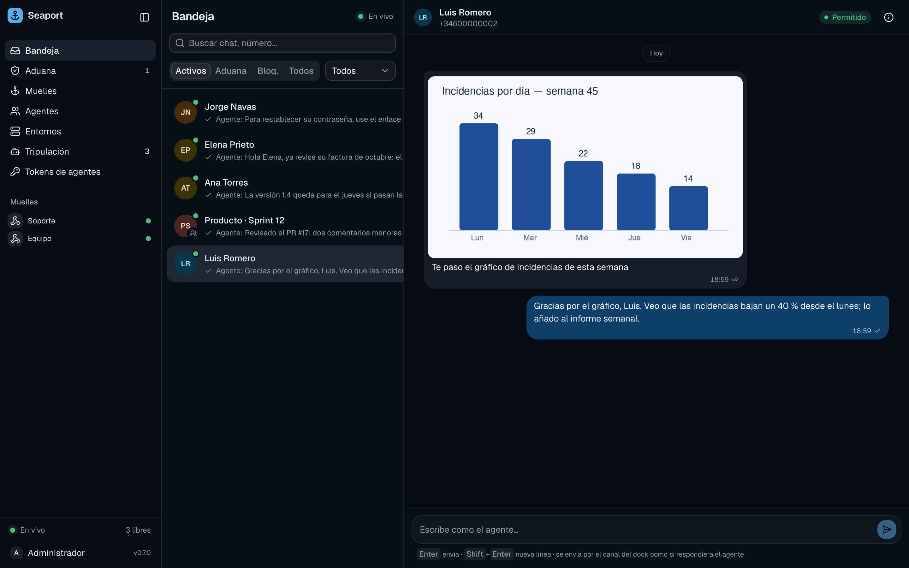

# Messages and images

A message in Seaport is text plus attachments. Whatever the channel sends (a WhatsApp photo with a caption, a Slack message with an image, an `api` post with images, a GitHub comment) is turned into that, and from there on everything treats it the same. This page covers what is kept, what isn't, how agents see images, and the limits on what you send back.



## Text

A message's text is up to 64 KiB. For a photo, the caption is the text. On WhatsApp, a message with only an image has an empty text and one attachment.

## Images

Images arrive with their message on **WhatsApp**, **Slack** (image files attached to the message) and **`api`** docks. GitHub and Jira messages arrive as text only: images in a comment are not fetched. Seaport downloads each one when the message arrives (WhatsApp's links expire quickly), then checks it:

| Check | Rule |
| :--- | :--- |
| Format | JPEG, PNG, WebP or GIF, decided from the file's bytes, not its name or declared type |
| Size | at most 3.75 MiB (3,932,160 bytes), so its base64 stays within the 5 MB that common models accept |
| Per message | up to 10 attachments |

An image that passes is kept **sealed** (encrypted with the port's secret key) in blob storage and shown in the web app.

An image that doesn't pass, or can't be kept, doesn't lose the message. A note is added to its text instead:

| Note | Why |
| :--- | :--- |
| `[image received; too large to keep]` | over 3.75 MiB |
| `[image received; unsupported format]` | not one of the four formats |
| `[image received; the download failed]` | the channel's download failed or was empty |
| `[image received; media storage is off]` | no blob storage is configured |
| `[image received; not kept from a denied sender]` | customs denied the chat or the sender: strangers can't fill your storage. Media from **pending** chats is kept, since allowing the chat delivers what it sent meanwhile |
| `[image received; it could not be stored]` | the blob store failed |

### Other media

Only images are supported. On Slack, only image files are fetched, and only from Slack's own hosts; other attached files are named in the text as `[file: name]` and not downloaded. On WhatsApp, a video, document, audio, sticker, location or contact arrives as text only: `[video] caption` when it has a caption, otherwise `[video received; media is not supported yet]` (with the matching word). The file itself is not downloaded or kept.

### On an `api` dock

Post images in the `images` field, base64-encoded. The whole request body stays within 1 MiB, which also bounds the images you can post this way. See [API docks](api-docks.md).

## How agents see images

The prompt names each attachment under its message line. How the agent looks at them depends on the harness:

- **The connector shows them.** If the harness advertises image support in ACP (`promptCapabilities.image`), the connector fetches each image from the port with the agent's token and sends it as an image block after the text, in order, up to **8 per prompt**. The prompt marks each one as attached below. Images that arrive while the agent is working (steering) are sent the same way.
- **Otherwise, the agent asks.** If the harness doesn't take images, an image beyond the first 8, or one that couldn't be fetched, the prompt says the attachment is "not shown to you". The agent can call the MCP tools: `history` lists each message's attachments with their ids, and `attachment` returns one as an image. These tools only work on conversations of the docks the agent is on.

See [The connector](connector.md#images).

## Files agents send

An agent's reply can carry files: a QA report, screenshots, a log. It sends them with the MCP `reply` tool (`files`, base64) or, for files on disk, from its shell:

```bash
seaport reply <conversation_id> -file qa-report.md -file checkout.png "QA done: 2 issues"
```

`seaport reply` uses `SEAPORT_URL` and `SEAPORT_CREW_TOKEN`, which the connector passes to the agent it runs (and hosted slots have). Limits: 10 files, 10 MiB each, 25 MiB together; names without paths.

Seaport keeps each file sealed as an attachment of the outbound message, like inbound images, so the history and the web app show what was sent. Images (the four formats above, up to 3.75 MiB) show inline; any other file is a **document**, served only as a download and never rendered (HTML, SVG and other types a browser could run are stored as `application/octet-stream`). Then the channel delivers them:

| Channel | Delivery |
| :--- | :--- |
| GitHub | One commit to the `seaport-files` branch of the repository (made on first use, without history from your code) under `pr-<number>/<message id>/`. The comment shows the images and links the other files at that commit, so links keep working. Readers need access to the repository. |
| WhatsApp | The text, then each file as its own message: an image message or a document with its name. |
| Slack | Uploaded to the conversation's thread after the text. The app needs the `files:write` scope; without it the reply fails with a message saying to add the scope and install the app again. |
| Jira | Refused: a reply with files fails and nothing is sent. Reply with text and link to the files with full URLs. |
| `api` | Kept with the message; your client reads them from `GET /api/v1/attachments/{id}`. |

Files need blob storage: on a port without it (`SEAPORT_BLOB_URL=off` or no secret key) a reply with files is refused, not sent without them. The `seaport-files` branch grows with each file. Links point at the commit that added a file, so deleting old folders in a later commit doesn't break them (nor shrink the repository: the history keeps them). To reclaim the space, delete the branch; the links of its files then stop working once GitHub drops the unreachable commits.

## Storage

Images are stored in a blob store:

| `SEAPORT_BLOB_URL` | Meaning |
| :--- | :--- |
| unset | a `blobs` directory next to the secret key file (`/data/blobs` in the Docker image) |
| `file:///path` | a local directory (one node) |
| `s3://bucket?region=…` | S3 or a compatible store; credentials come from the standard `AWS_*` variables |
| `off` | no media is kept; each image becomes a note |

Every file is sealed with `SEAPORT_SECRET_KEY` before it is written, and each is bound to its organization and attachment, so a copied blob doesn't open elsewhere. Keep that key with your backups: without it the images can't be read. The bucket holds only opaque files; Seaport never lists it, and the database is the index.

Deleting a dock, a conversation or a message deletes its images; a sweeper removes the blobs within about a minute. The port's secret key and blob store are covered in [Configuration](../reference/configuration.md) and [Backups and upgrades](operations/backups-and-upgrades.md).

Images and documents are served only to people with the permission to read messages (`ships:read`) and to agents for their own docks, always as downloads that can't run as web pages.

## Sending limits

Replies go out through the channel, so Seaport limits how fast you send. WhatsApp can suspend a number that sends too much, and a loop in an agent shouldn't flood a channel. The limits apply to every dock, whatever its channel, and to every reply: an agent's `reply` tool, `seaport send`, and the composer in the web app.

| Limit | Default | Setting |
| :--- | :--- | :--- |
| per conversation, per minute | 8 | `SEAPORT_SEND_PER_CHAT_MINUTE` |
| per dock, per minute | 20 | `SEAPORT_SEND_PER_MINUTE` |
| per dock, per hour | 300 | `SEAPORT_SEND_PER_HOUR` |
| per organization, per hour | 1000 | `SEAPORT_SEND_ORG_PER_HOUR` |

Setting one to `0` turns it off. A reply over a limit is **refused**: the API answers `429` with a `Retry-After` header (and `retry_after_seconds` in the error), nothing is stored or sent, and an agent's `reply` tool gets the error with the wait, so it can try later. You can only reply to **allowed** conversations; others are refused.

A reply is stored before it is sent, with its status `pending`, then `sent` or `failed` (with the error). A failed reply stays in the history, and the web app shows "no se envió".
