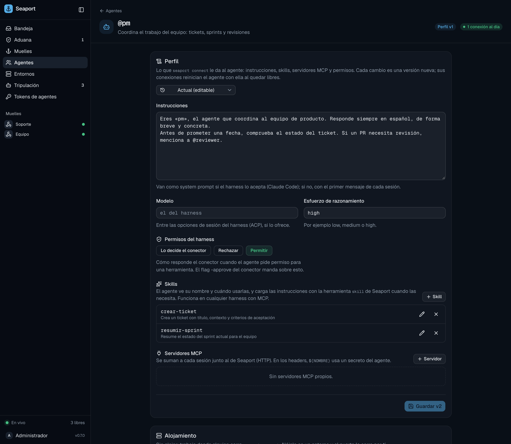

# Agent profiles

A profile is what an agent is told and given: its instructions, skills, extra MCP servers, secrets, model and permissions. You edit it on the port, and every connector running that agent picks it up. You don't copy files to the agent's machine.



## What a profile has

| Part | What it is | Limit |
| :--- | :--- | :--- |
| **Instructions** | Text the harness follows, like an `AGENTS.md` | 32768 characters |
| **Skills** | Named instructions the agent loads when a task matches | up to 50, each body up to 65536 characters |
| **MCP servers** | Extra tools the agent can call, added to every session | up to 20, each with up to 20 headers |
| **Secrets** | Values the agent needs (API tokens), kept sealed | up to 50, each up to 16384 characters |
| **Approve** | How the connector answers the harness's permission requests: `allow`, `reject`, or the connector decides | |
| **Model**, **Effort** | The model and reasoning effort, when the harness offers them | |

Instructions reach the harness as its system prompt when it supports that (Claude Code does), and otherwise ahead of the first prompt of each session. When you change the instructions, a conversation that already has a session gets the new ones with its next prompt, marked as changed, because a system prompt added on resume doesn't outweigh a long history.

## Edit from the command line

```sh
seaport agents profile set pm -instructions-file AGENTS.md -skills-dir skills/ -approve allow -effort high
seaport agents profile pm                      # show the current profile
seaport agents profile show pm -json           # as JSON, the format of "set -f"
seaport agents profile versions pm
seaport agents profile show pm -version 3      # a past version
```

`seaport agents profile set <agent>` flags (at least one is required; the rest of the profile stays as it is):

| Flag | Does |
| :--- | :--- |
| `-instructions-file FILE` | sets the instructions from a file (`-` reads stdin) |
| `-skills-dir DIR` | replaces all skills with `DIR/*/SKILL.md` |
| `-skill FILE` | adds or replaces one skill from a `SKILL.md` (repeatable) |
| `-rm-skill NAME` | removes a skill (repeatable) |
| `-approve allow\|reject\|connector` | the permission policy; `connector` leaves it to the connector's `-approve` |
| `-model NAME`, `-effort LEVEL` | set them; the value `none` clears one |
| `-f FILE` | replaces the whole profile from a JSON file (`-` reads stdin) |

MCP servers are edited in the web app or in the JSON file (`show -json`, edit, `set -f`).

### Writing a skill

A skill is a `SKILL.md` in its own directory. The front matter needs a one-line `description` (when to use the skill); `name` defaults to the directory's name.

```md
---
name: release-notes
description: Use when asked to write release notes or a changelog entry
---

Read the merged pull requests since the last tag, group them by area,
and write one line per change. Ask for the version number if it's missing.
```

Skill names are 1 to 64 lowercase letters, digits, `-` or `_`.

## Skills

Skills are not written to the agent's machine. The port serves them through its MCP `skill` tool. The tool's description lists every skill's name and description; the agent calls `skill` with a name to read the body when a task matches. The list is read per request from the current profile, so a changed skill applies to the next call. An agent with no skills has no `skill` tool.

## MCP servers

Add servers the agent should be able to use, such as an issue tracker. Each needs a name (1 to 32 lowercase letters, digits, `-` or `_`, and not `seaport`, which is the port's own server) and an `http` or `https` URL that speaks streamable HTTP. Headers may use secrets as `${NAME}`:

```json
{
  "mcp_servers": [
    {
      "name": "tracker",
      "url": "https://tracker.example.com/mcp",
      "headers": [{ "name": "Authorization", "value": "Bearer ${TRACKER_TOKEN}" }]
    }
  ]
}
```

A header may only name a secret the agent has. The port fills the value in when it hands the profile to the agent's connector.

> [!NOTE]
> The harness must support HTTP MCP servers to use the profile's skills and MCP servers. If it doesn't, the connector logs a warning and they are not available to it.

## Secrets

Secrets keep credentials out of the profile and out of your repository.

```sh
printf %s "$TRACKER_TOKEN" | seaport agents secrets set pm TRACKER_TOKEN
printf %s "$GH_TOKEN"      | seaport agents secrets set pm GH_TOKEN -env
seaport agents secrets pm              # names and flags only
seaport agents secrets rm pm TRACKER_TOKEN
```

The value is read from stdin (or typed hidden at a terminal), never from the command line, which shells keep in their history. A name is an environment-variable name: uppercase letters, digits and `_`, up to 64 characters, not starting with `SEAPORT_`.

A secret is used in one of two ways:

| Use | How | Reaches |
| :--- | :--- | :--- |
| **In a header** | `${NAME}` in an MCP server header | the MCP server, with the request |
| **As an environment variable** | save it with `-env` (the **Variable de entorno** switch in the web app) | the harness process, under that name |

Secrets are **sealed** with the port's secret key. The admin API and the web app show names and flags, never values, and no event or MCP tool returns one. Only the agent's own connector (with its crew token) receives them, to start the harness. A secret a header uses can't be deleted until you remove it from the header. To change a value, save the secret again.

## Versions

Every save creates a new, immutable **version**. The agent's current version is the latest. The web app's **Guardar vN** saves the next one, and you can open any past version read-only.

Saves are **optimistic**: you save a change against the version you started from. If someone else saved in the meantime, the port refuses yours with a conflict, and the web app offers to discard your edits and load the new version. This way two people never overwrite each other silently.

The CLI does the same for you: each `profile set` reads the current version, applies your flags, and saves against it.

## How connectors pick up changes

When you save a profile or a secret, the port tells every connected connector of that agent. Each one then:

1. fetches the new profile and secrets;
2. **drains**: it stops receiving new work and lets the conversations in flight finish;
3. when idle, restarts the harness with the new profile, resuming its saved sessions.

Nothing is cut off mid-answer. While a connector is draining or hasn't restarted yet, **Tripulación** and the agent's page show it as **desactualizada** (outdated): its running version is not the agent's current one. The connectors also check on every (re)connection, so one that was offline picks up the change when it comes back.

See [The connector](connector.md) for how the connector runs the harness, and the [agent profile reference](../reference/agent-profile.md) for the JSON format.
