# The web app

The web app is where you run a port day to day: read conversations, decide who gets in, manage docks, agents and tokens, and watch your crew work. This page tours it, page by page.

The interface is in Spanish. Each name below is followed by its English meaning. The app ships inside the `seaport` binary and is served by the port itself, at `http://127.0.0.1:8740` by default. A binary built with `go install` has no web app; use a release binary or the Docker image (see [Installation](installation.md)).

## Sign in

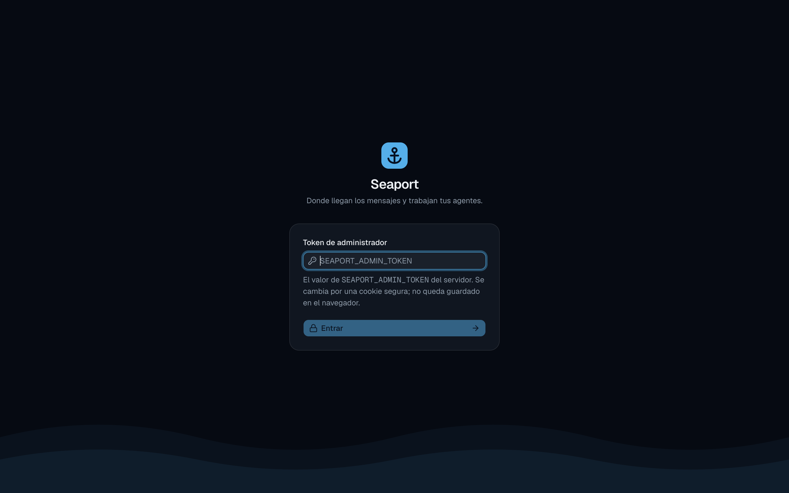

What you see depends on the port's mode (`SEAPORT_AUTH`):

| Mode | Sign-in |
| :--- | :--- |
| `none` | None. The app opens directly; the account menu says **Local**. |
| `token` | A **Token de administrador** field (the value of `SEAPORT_ADMIN_TOKEN`) and **Entrar**. A wrong token shows "Ese token no es el del puerto." The port exchanges it for an HttpOnly session cookie. |
| `iam` | **Iniciar sesión**, which goes through IAMKit and returns you to the page you wanted. |

See [Operations: IAM mode](operations/iam-mode.md) for the `iam` setup.

## The shell

A sidebar lists the sections you may use. A section you have no permission for is not shown.

| Section | What it is |
| :--- | :--- |
| **Bandeja** (Inbox) | every conversation, and the chat panel |
| **Aduana** (Customs) | chats waiting for a decision, and each dock's rules. A badge counts the pending ones. |
| **Muelles** (Docks) | your channels. The docks are listed under it, each with a status dot. |
| **Agentes** (Agents) | the agent library |
| **Entornos** (Environments) | where [hosted agents](hosting/hosted-agents.md) run |
| **Tripulación** (Crew) | connected agents. A badge counts them. |
| **Tokens de agentes** (Agent tokens) | credentials agents connect with |

The footer shows the [live indicator](#live-updates) and a summary of the crew: "N en curso" (agents working), "N libre(s)" (idle) or "sin agentes". The account menu shows who you are (**Administrador**, **Local**, or your name and organization in `iam` mode), the version, the theme, and **Cerrar sesión** (sign out). In `iam` mode it also has **Cambiar de organización** (switch organization). On a phone, the sidebar opens from a header button.

## Bandeja (Inbox)

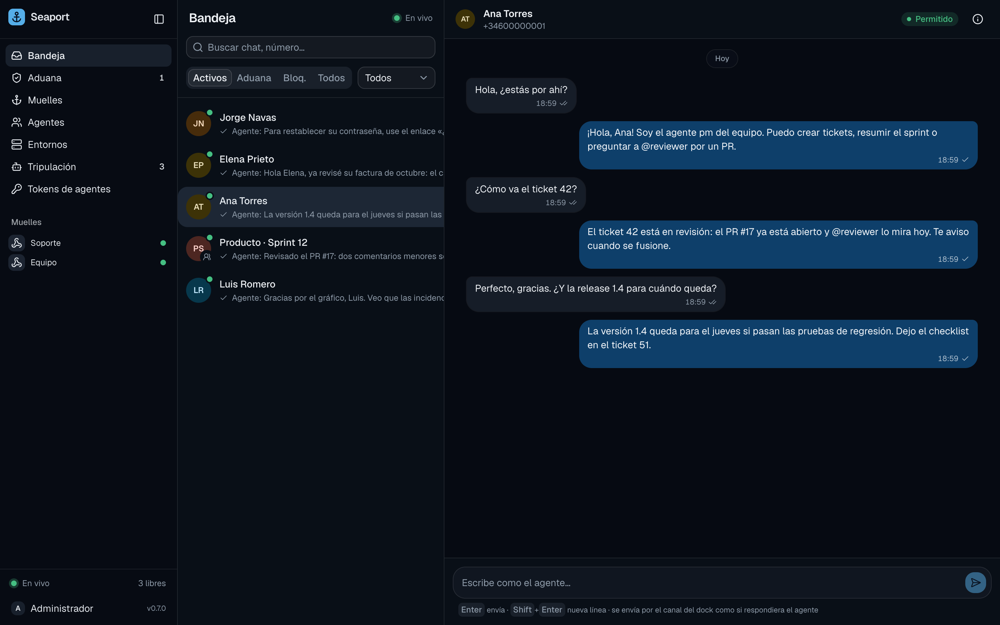

The left column lists conversations. Search by name, phone number or handle with **Buscar chat, número…**, filter by status with the tabs, and by dock with the dropdown (shown when you have more than one dock):

| Tab | Shows |
| :--- | :--- |
| **Activos** | allowed chats (the default tab) |
| **Aduana** | pending chats |
| **Bloq.** | denied chats |
| **Todos** | all of them |

Each row has the chat's name, a preview of the last message (agent messages start with "Agente:") and an icon for groups.

### The conversation panel

Select a conversation to read it. Messages are oldest to newest, with day dividers; **Mensajes anteriores** loads older ones. Inbound messages are on the left, and in groups they show the sender's name. Messages sent by agents (or by you) are on the right; when several agents work in the chat, each bubble names its `@agent`. Hover a message's time to see its status. A held message shows why, for example "esperando tu decisión en la aduana" or "no se llamó a ningún agente (@nombre)". See [held reasons](../explanation/message-lifecycle.md#held-reasons). A failed send shows its error.

In GitHub and API conversations, message text is rendered as Markdown: bold, lists, tables, task lists, inline code, code blocks and GitHub's `suggestion` blocks (labelled "Sugerencia de cambio"). Links open in a new tab, and only absolute `http(s)` and `mailto` links are followed; relative paths stay plain text. Raw HTML is not rendered, and remote images show as links, never loaded. WhatsApp text shows as typed, because WhatsApp has its own formatting.
While an agent works on the chat, the header shows "@name está respondiendo…" and typing bubbles. Below them, a panel shows what the agent is doing as it happens: its thinking, its own text, and each tool it calls with its title, status (running, done, failed) and duration. Click the panel's header to fold it. Only titles and status are shown, never a tool's input or output. Seeing it takes `seaport:ships:read`.

The live panel is not stored. If you open the chat while the agent is already working, you see what it does from then on. The agent's connector sends this activity (`seaport connect` does it for every ACP harness; see the [`activity` frame](../reference/crew-protocol.md#activity)).

When the turn ends, the panel folds into a line under the agent's answer, such as "@ventas trabajó 12s · 3 herramientas". Click it to see the tools again with their status and duration. This summary is stored with the conversation, so it stays after a reload. It keeps the tools only (title, kind, status and timing, with secret-looking strings in titles replaced by `[redacted]`), never the agent's thinking or text. A turn that failed reads "falló tras…" and one cut by a disconnect "se desconectó tras…". Turns without tool calls leave no summary.

Images sent to the chat show inline:

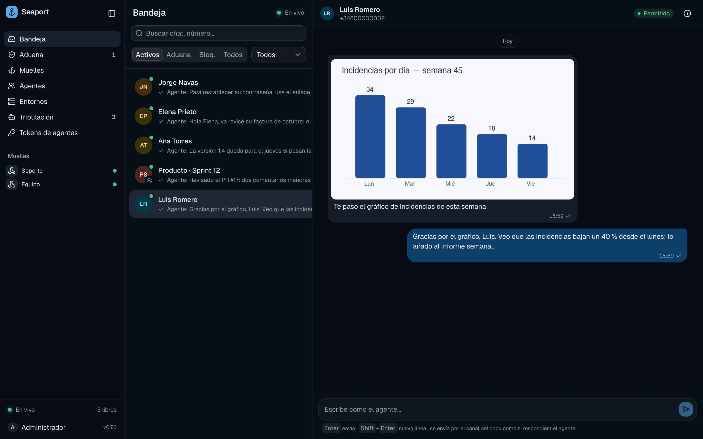

See [Messages and images](messages-and-images.md).

### Reply as the agent

The composer at the bottom ("Escribe como el agente…") sends a message through the dock's channel as if the agent had answered. **Enter** sends, **Shift+Enter** adds a line. It needs the `ships:write` permission, and it is disabled until the chat is allowed ("Permite este chat para poder responder.") and for blocked chats. Outbound [limits](messages-and-images.md#sending-limits) apply to you too.

### Pending chats

A pending chat shows a banner: "En aduana. Sus mensajes se guardan pero no despiertan al agente hasta que lo permitas." with **Bloquear** (block) and **Permitir** (allow) buttons.

### The side panel

The (i) button opens **Detalles**:

- **Acceso** (access) is your override for this chat: **Reglas** lets the dock's customs decide, **Permitir** always lets it in, **Bloquear** never does. See [Customs](customs.md#the-order-of-decisions).
- For groups, **Mensajes del grupo** sets the group mode for this chat: **Como el muelle** (the dock's mode), **Solo menciones** (only messages that name the agent) or **Todo**.
- Below are the channel, the chat id, its identities (phone numbers and ids), the last activity, the creation date and the conversation id.

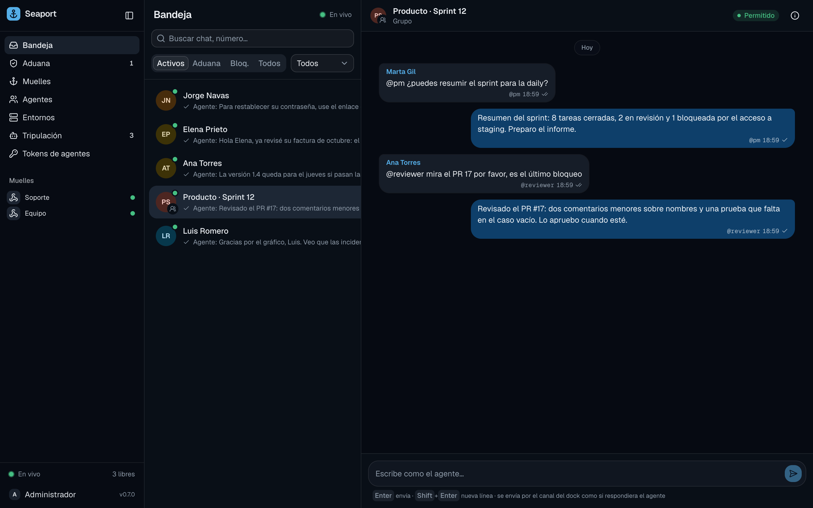

Allowing a direct chat hands the agent what it sent while it waited (the last 24 hours, the newest 50 at most); see [Customs: messages that wait](customs.md#messages-that-wait).

## Aduana (Customs)

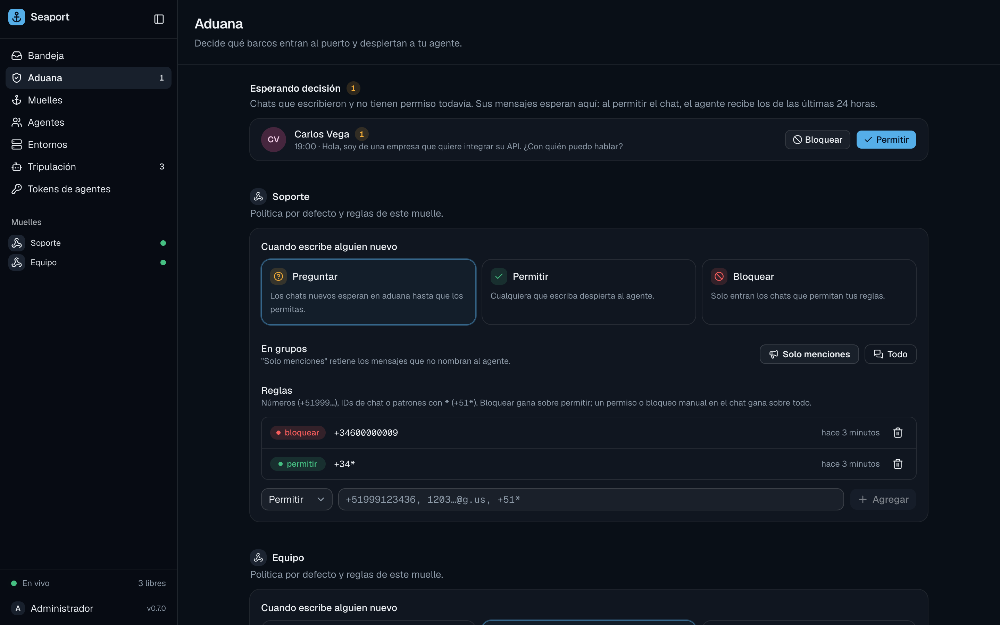

The top lists **chats waiting for a decision**, with the number of held messages each, and allow/block buttons. Below, for each dock, you edit the **default policy**, the **group mode** and the **rules**. Everything here is explained in [Customs](customs.md).

## Muelles (Docks)

The list shows each dock with its channel and status. **Nuevo muelle** opens a dialog:

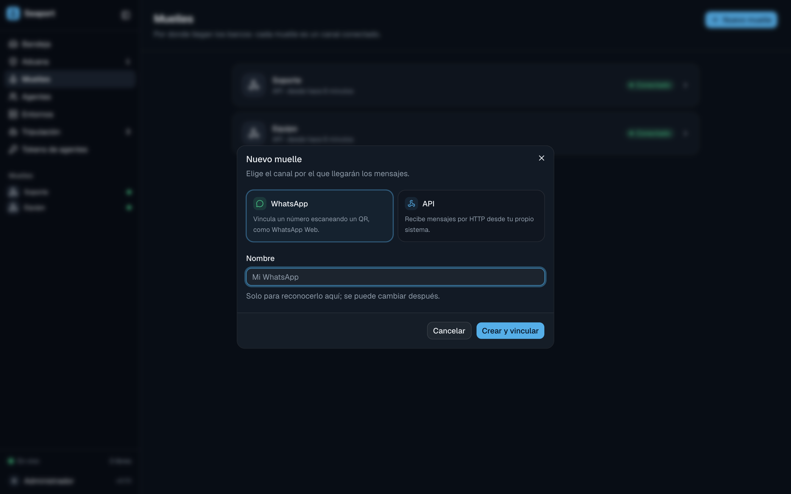

Pick the channel (WhatsApp or API) and give it a name (only for you; you can rename it later). For WhatsApp, **Crear y vincular** continues to the QR code; see [WhatsApp](whatsapp.md).

A dock's page shows:

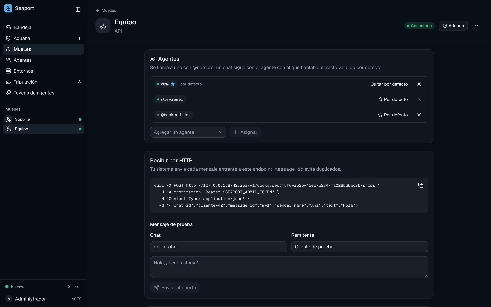

- **Agentes**, the dock's **team of agents**. Add agents from the library, remove them, and star one as the default. The card explains how messages are routed with the current team; see [Agents and routing](agents-and-routing.md#routing).
- **Detalles** and **Conversaciones** of the dock.
- On an `api` dock, **Recibir por HTTP**: the `curl` command that posts a message (with `message_id` to avoid duplicates), and **Mensaje de prueba** (test message), a form (**Chat**, **Remitente**, text, **Enviar al puerto**) that injects one without writing code. See [API docks](api-docks.md).

## Agentes (Agents)

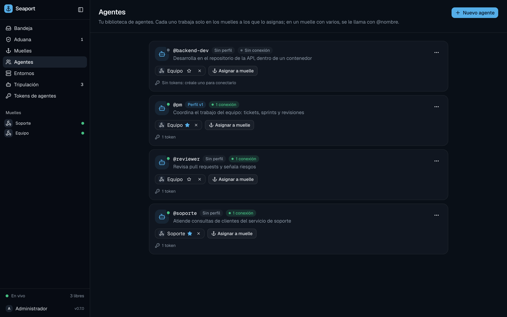

Each agent is a row with its name (`@name`), its profile version, and the docks it works on (a star marks where it is the default). **Nuevo agente** creates one; the row menu edits or deletes it. **Asignar a muelle** puts it on a dock. Removing an agent from a dock, or deleting it, holds the messages that waited for it; deleting also revokes its tokens and closes its connections.

Open an agent to edit its profile:

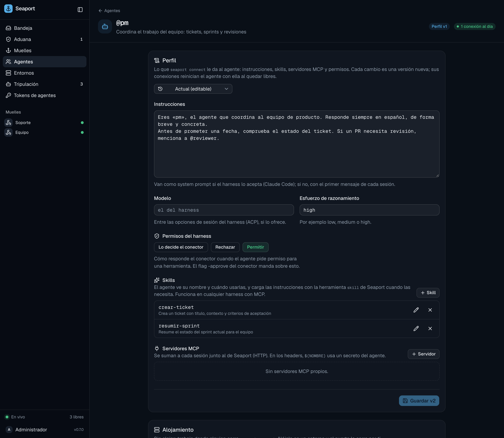

The page has instructions, model, reasoning effort, harness permissions, **skills**, **MCP servers** and **secrets**. Every save is a new version (**Guardar vN**). Connections still running an older version show a badge ("N conexión desactualizada"). Details are in [Agent profiles](profiles.md).

## Entornos (Environments)

An environment says where a [hosted agent](hosting/hosted-agents.md) runs: harness, image, tools, repositories, network and resources. Every change is a new version.

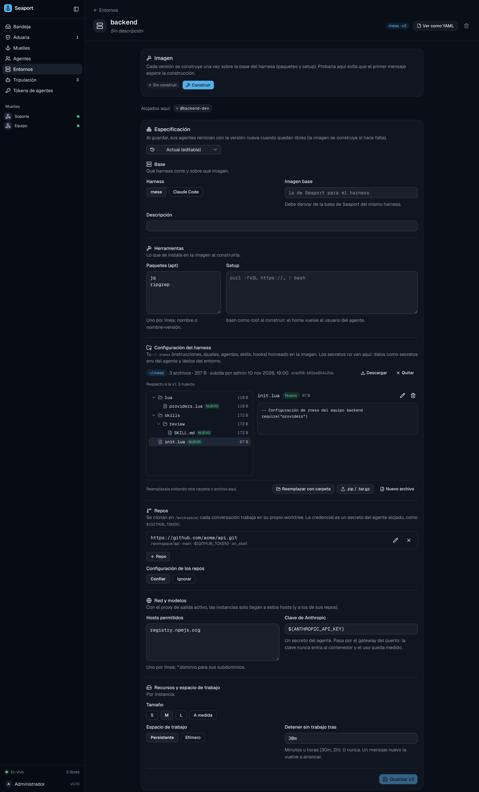

The page has the sections **Base**, **Herramientas**, **Configuración del harness** (the harness's own settings, such as `CLAUDE.md` or skills, uploaded from a folder or archive; see [Harness homes](hosting/harness-homes.md)), **Repos**, **Red y modelos** and **Recursos y espacio de trabajo**. If you only connect agents from your own machines, you can ignore this section.

## Tripulación (Crew)

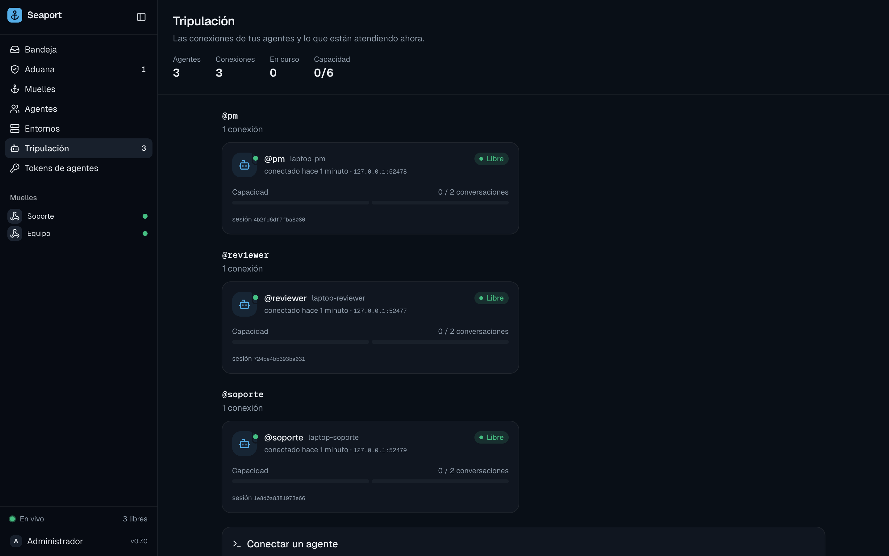

Connected agents, grouped by `@name`, one card per connection, with what each is working on right now. The **Conectar un agente** card at the bottom has the `seaport connect` command for this port. See [The connector](connector.md).

## Tokens de agentes (Agent tokens)

The list shows each token's name, agent, the start of its value, when it was created, last used and when it expires. **Revocar** revokes it, which also closes its live connections. **Nuevo token** asks for the agent, a name and a lifetime (30 days, 90 days, 1 year or **Sin vencimiento**), then shows the value once. Copy it then: Seaport keeps only its hash. See [Crew tokens](agents-and-routing.md#crew-tokens).

## Live updates

The app does not poll. It keeps one connection to the port's event stream (server-sent events, `/api/v1/events`) and updates lists and conversations as things happen. The footer indicator shows its state: **En vivo** (green), **Conectando…** or **Sin conexión**. When the connection drops, the app reconnects and resumes where it left off, or reloads its data if it was away too long.

## Theme

Open the account menu and choose **Tema**: **Claro** (light), **Oscuro** (dark) or **Sistema** (follow your OS). The screenshots in these docs use the dark theme.

## Permissions

The app shows only what you may do. Sections you can't read are missing from the sidebar, and a page you can't open shows a "no access" message. Buttons that need a write permission (allow, block, create, revoke, reply) are hidden or disabled.

In `none` and `token` modes the person using the app can do everything. In `iam` mode, roles come from IAMKit: **Admin**, **Operator** and **Viewer**. See [Permissions](../reference/permissions.md) and [Operations: IAM mode](operations/iam-mode.md).
