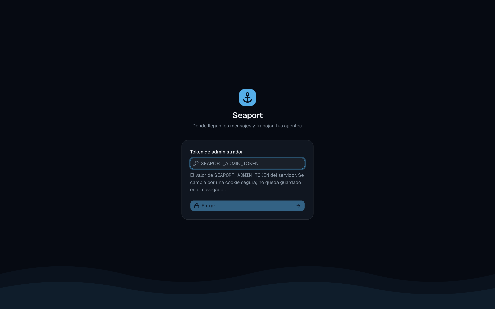
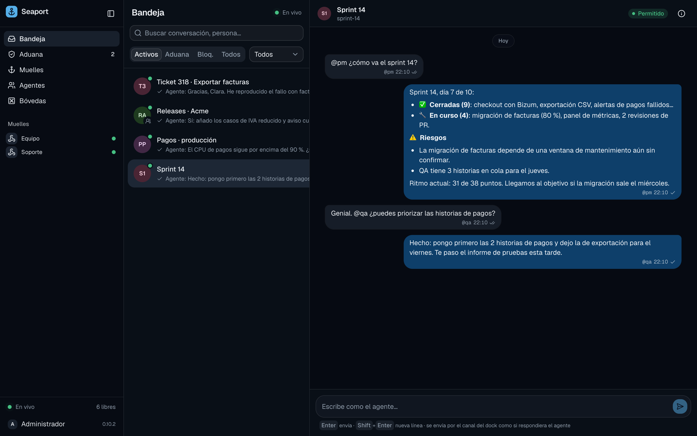
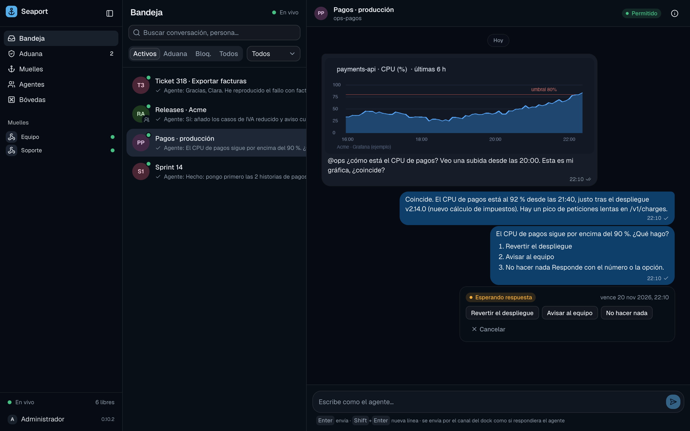
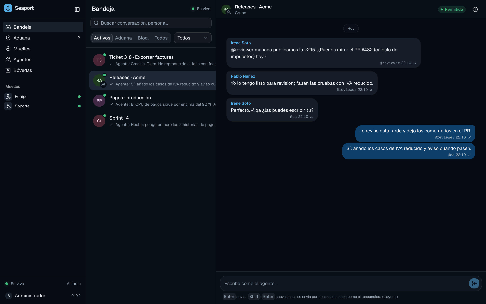
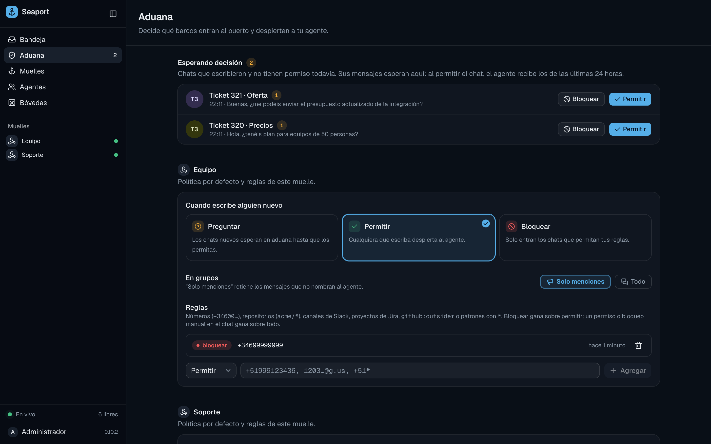
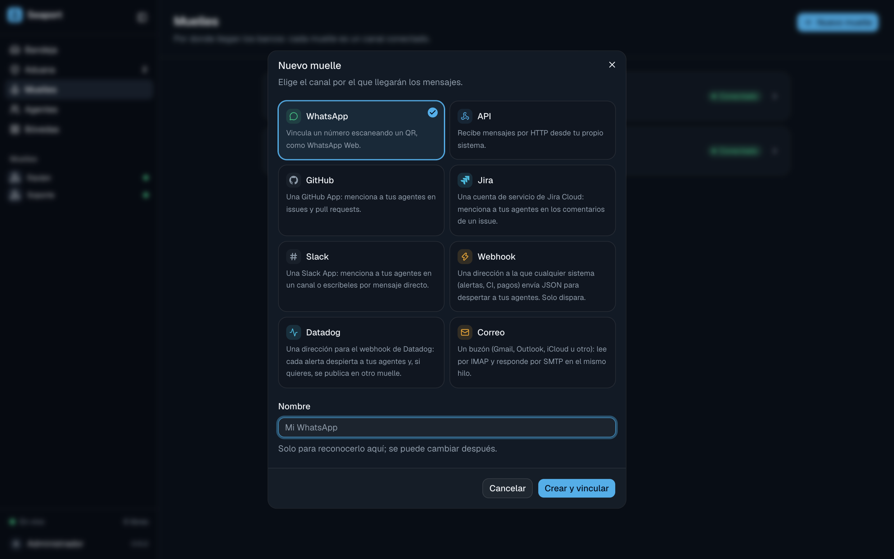
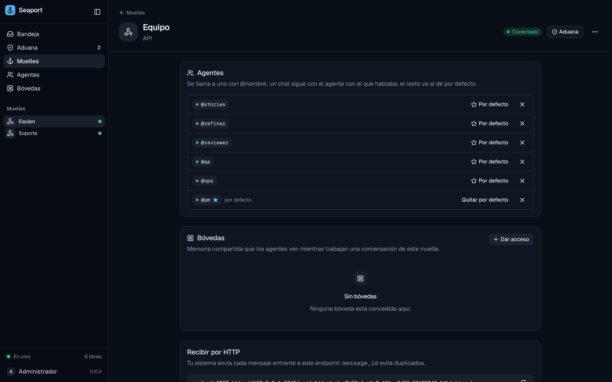
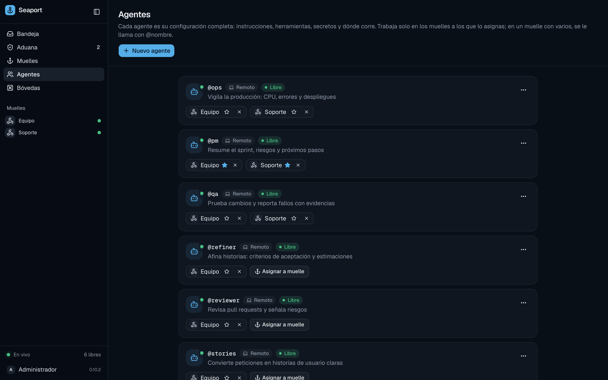
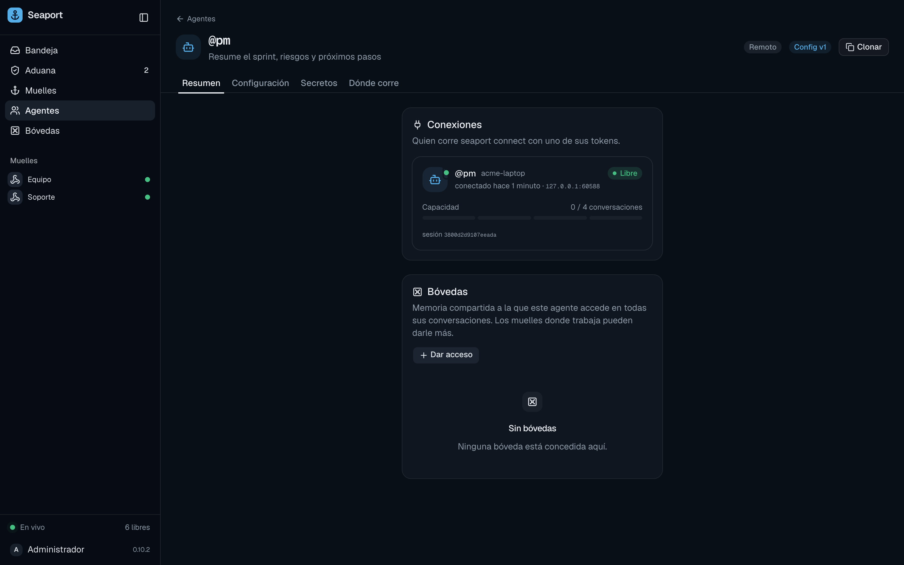

# The web app

The web app is where you run a port day to day: read conversations, decide who gets in, manage docks, agents and tokens, and watch your crew work. This page tours it, page by page.

The interface is in Spanish. Each name below is followed by its English meaning. The app ships inside the `seaport` binary and is served by the port itself, at `http://127.0.0.1:8740` by default. A binary built with `go install` has no web app; use a release binary or the Docker image (see [Installation](installation.md)).

## Sign in

What you see depends on the port's mode (`SEAPORT_AUTH`):

| Mode | Sign-in |
| :--- | :--- |
| `none` | None. The app opens directly; the account menu says **Local**. |
| `token` | A **Token de administrador** field (the value of `SEAPORT_ADMIN_TOKEN`) and **Entrar**. A wrong token shows "Ese token no es el del puerto." The port exchanges it for an HttpOnly session cookie. |
| `iam` | **Iniciar sesión**, which goes through IAMKit and returns you to the page you wanted. |

See [Operations: IAM mode](operations/iam-mode.md) for the `iam` setup.

## The shell

A sidebar lists the sections you may use. A section you have no permission for is not shown.

| Section | What it is |
| :--- | :--- |
| **Bandeja** (Inbox) | every conversation, and the chat panel |
| **Aduana** (Customs) | chats waiting for a decision, and each dock's rules. A badge counts the pending ones. |
| **Muelles** (Docks) | your channels. The docks are listed under it, each with a status dot. |
| **Agentes** (Agents) | the agent library: where each runs and what it is doing. A badge counts the connections working. |
| **Miembros** (Members) | `iam` mode with the members settings, for organization administrators: [people, invitations and API keys](members.md) |

The footer shows the [live indicator](#live-updates) and a summary of the crew: "N en curso" (agents working), "N libre(s)" (idle) or "sin agentes". The account menu shows who you are (**Administrador**, **Local**, or your name and organization in `iam` mode), the version, the theme, and **Cerrar sesión** (sign out). In `iam` mode it also has **Cambiar de organización** (switch organization). On a phone, the sidebar opens from a header button.

## Bandeja (Inbox)

The left column lists conversations. Search by name, phone number or handle with **Buscar chat, número…**, filter by status with the tabs, and by dock with the dropdown (shown when you have more than one dock):

| Tab | Shows |
| :--- | :--- |
| **Activos** | allowed chats (the default tab) |
| **Aduana** | pending chats |
| **Bloq.** | denied chats |
| **Todos** | all of them |

Each row has the chat's name, a preview of the last message (agent messages start with "Agente:") and an icon for groups.

### The conversation panel

Select a conversation to read it. Messages are oldest to newest, with day dividers; **Mensajes anteriores** loads older ones. Inbound messages are on the left, and in groups they show the sender's name. Messages sent by agents (or by you) are on the right; when several agents work in the chat, each bubble names its `@agent`. Hover a message's time to see its status. A held message shows why under its text, for example "esperando tu decisión en la aduana" or "no se llamó a ningún agente (@nombre)". See [held reasons](../explanation/message-lifecycle.md#held-reasons). A failed send shows its error.

When the chat's newest message is held by routing (nobody works the dock, nobody was called, or its agent left), a banner above the messages says why. With `seaport:agents:write` you pick an agent there: **Asignar** adds it to the dock's team, or, when the dock already has a team, **Hacer por defecto** makes it the default. The held message then goes to that agent; nobody has to send it again. Messages older than 24 hours aren't delivered this way, and the banner says so. Without that permission the banner links to the dock.

When an agent with the [managed browser](hosting/browser.md) asked a person to take over a site for this conversation, a banner names the site with **Abrir navegador** (the agent's browser in a dialog, opened on that site) and **Listo** (the person is done: the agent wakes up and goes on). The header also has a browser button per agent of the dock that has one, to reach its browser at any time. With no slot running, the dialog offers to start one. Both need `seaport:browser:use`.

In GitHub, Jira, Slack and API conversations, message text is rendered as Markdown: bold, lists, tables, task lists, inline code, code blocks and GitHub's `suggestion` blocks (labelled "Sugerencia de cambio"). Links open in a new tab, and only absolute `http(s)` and `mailto` links are followed; relative paths stay plain text. Raw HTML is not rendered, and remote images show as links, never loaded. WhatsApp text shows as typed, because WhatsApp has its own formatting.
While an agent works on the chat, the header shows "@name está respondiendo…" and typing bubbles. Below them, a panel shows what the agent is doing as it happens: its thinking, its own text, and each tool it calls with its title, status (running, done, failed) and duration. Click the panel's header to fold it. Only titles and status are shown, never a tool's input or output. Seeing it takes `seaport:ships:read`.

The live panel is not stored. If you open the chat while the agent is already working, you see what it does from then on. The agent's connector sends this activity (`seaport connect` does it for every ACP harness; see the [`activity` frame](../reference/crew-protocol.md#activity)).

When the turn ends, the panel folds into a line under the agent's answer, such as "@ventas trabajó 12s · 3 herramientas". Click it to see the tools again with their status and duration. This summary is stored with the conversation, so it stays after a reload. It keeps the tools only (title, kind, status and timing, with secret-looking strings in titles replaced by `[redacted]`), never the agent's thinking or text. A turn that failed reads "falló tras…" and one cut by a disconnect "se desconectó tras…". Turns without tool calls leave no summary.

Images sent to the chat show inline:

See [Messages and images](messages-and-images.md).

### Reply as the agent

The composer at the bottom ("Escribe como el agente…") sends a message through the dock's channel as if the agent had answered. **Enter** sends, **Shift+Enter** adds a line. It needs the `ships:write` permission, and it is disabled until the chat is allowed ("Permite este chat para poder responder.") and for blocked chats. Outbound [limits](messages-and-images.md#sending-limits) apply to you too.

### Pending chats

A pending chat shows a banner: "En aduana. Sus mensajes se guardan pero no despiertan al agente hasta que lo permitas." with **Bloquear** (block) and **Permitir** (allow) buttons.

### The side panel

The (i) button opens **Detalles**:

- **Acceso** (access) is your override for this chat: **Reglas** lets the dock's customs decide, **Permitir** always lets it in, **Bloquear** never does. See [Customs](customs.md#the-order-of-decisions).
- For groups, **Mensajes del grupo** sets the group mode for this chat: **Como el muelle** (the dock's mode), **Solo menciones** (only messages that name the agent) or **Todo**.
- **Hilo** (thread) lists the conversations linked with this one and lets you **Enlazar** (link) another or **Separar** (unlink) this one. Linked conversations show a bar of chips under the header; **Hilo** there shows every conversation's messages together, each labelled with its channel. See [Linked conversations](linked-conversations.md).
- Below are the channel, the chat id, its identities (phone numbers and ids), the last activity, the creation date and the conversation id (and the thread id, when linked).

Allowing a direct chat hands the agent what it sent while it waited (the last 24 hours, the newest 50 at most); see [Customs: messages that wait](customs.md#messages-that-wait).

## Aduana (Customs)

The top lists **chats waiting for a decision**, with the number of held messages each, and allow/block buttons. Below, for each dock, you edit the **default policy**, the **group mode** and the **rules**. Everything here is explained in [Customs](customs.md).

## Muelles (Docks)

The list shows each dock with its channel and status. **Nuevo muelle** opens a dialog:

Pick the channel (WhatsApp, API, GitHub, Jira, Slack, Webhook or Correo) and give it a name (only for you; you can rename it later). For WhatsApp, **Crear y vincular** continues to the QR code; see [WhatsApp](whatsapp.md). GitHub, Jira, Slack and Correo docks show a card on their page to connect them; see [GitHub](github.md), [Jira](jira.md), [Slack](slack.md) and [Email](email.md). A Webhook dock shows its URL, secret and template ([Webhooks](webhooks.md)).

A dock's page shows:

- **Agentes**, the dock's **team of agents**. Add agents from the library, remove them, and star one as the default. The card explains how messages are routed with the current team; see [Agents and routing](agents-and-routing.md#routing).
- **Detalles** and **Conversaciones** of the dock.
- On an `api` dock, **Recibir por HTTP**: the `curl` command that posts a message (with `message_id` to avoid duplicates), and **Mensaje de prueba** (test message), a form (**Chat**, **Remitente**, text, **Enviar al puerto**) that injects one without writing code. See [API docks](api-docks.md).

## Agentes (Agents)

Each agent is a card with its name (`@name`), where it runs (**Alojado · N instancias** when the port hosts it, **Remoto** when people connect it), its state (**Trabajando**, **Libre**, **Desconectado**…) and the docks it works on (a star marks where it is the default). The card menu opens its configuration, edits, **Clonar** (clone) or deletes it. **Asignar a muelle** puts it on a dock. Removing an agent from a dock, or deleting it, holds the messages that waited for it; deleting also revokes its tokens and closes its connections.

**Nuevo agente** asks, step by step, for the name, where it runs (**En el puerto** or **Donde alguien lo conecte**), the harness and, for a hosted agent, how it reaches its models: **Cuenta de Claude** (each slot signs in to a subscription) or **Clave de API** (an Anthropic key, stored as the agent's secret, used only by the port's gateway; an rness agent's other providers go in its YAML). A hosted agent is created with a machine and hosted in one go; the rest of its machine (repositories, packages, files) is set later in **Configuración**. **Clonar** makes a new agent with the same config, and with its secrets when **Copiar sus secretos** is on; it is never hosted until you host it.

Open an agent to edit it. The agent's page is the one place for everything about it, in tabs:

| Tab | What it is |
| :--- | :--- |
| **Resumen** | Its connections (slots or machines), each with what it is working on, model usage and vaults. |
| **Configuración** | The whole [config](../reference/agent-config.md): the harness, the [profile](profiles.md) (instructions, model, reasoning effort, harness permissions, **skills** and **MCP servers**, browser) and, for an agent the port hosts, its machine and **Acceso a la IA**: how its slots reach Claude, in one place (**Cuenta de Claude**, with each slot's account and its **Conectar cuenta** button, or a **Clave de API**; other providers' keys for rness go in the YAML, and the form names and keeps them). Then repositories, packages, harness files and, under **Avanzado**, egress hosts, variables, resources and base image. **Ver como YAML** shows what `seaport agents config show` prints. |
| **Secretos** | The agent's [secrets](hosting/secrets.md): names and flags, never values, and what in the config uses each (a secret in use can't be deleted). |
| **Dónde corre** | Hosted: its slots, image build, logs and each slot's Claude account (a click goes to **Acceso a la IA**), **Pasar a remoto**. Remote: its tokens (**Nuevo token** shows the value once; Seaport keeps only its hash), the `seaport connect` command, and **Alojar en el puerto**. |
| **Navegador** | The agent's [managed browser](hosting/browser.md) and the takeovers it asks for (shown when its config has a browser). |

Every save is a new version of the agent's config (**Guardar vN**). Connections still running an older version show a badge ("N desactualizada"). The two modes are exclusive: hosting an agent revokes its tokens (the page asks first), and a hosted agent mints none. The tabs and their controls may change between releases; `seaport agents config show` and [Agent config](../reference/agent-config.md) are the exact description.

## Live updates

The app keeps one connection to the port's event stream (server-sent events, `/api/v1/events`) and updates lists and conversations as things happen. The footer indicator shows its state: **En vivo** (green), **Conectando…** or **Sin conexión**. When the connection drops, the app reconnects and resumes where it left off, or reloads its data if it was away too long.

If the stream doesn't get through for 10 seconds, the indicator reads **Sin conexión en vivo** and the app reloads what is on screen every 15 seconds (only while the tab is visible) until the stream connects again. A proxy or tunnel that buffers responses causes this; a [Cloudflare quick tunnel](https://developers.cloudflare.com/tunnel/get-started/quick-tunnels/#limitations) is one, since it doesn't carry server-sent events. While polling, you see new messages and each turn's tool summary when the turn ends, but not what an agent is doing while it works. Put the port behind a proxy that streams (the [deploy stack](operations/deploy.md)'s Caddy does) to get it live.

## Theme

Open the account menu and choose **Tema**: **Claro** (light), **Oscuro** (dark) or **Sistema** (follow your OS). The screenshots in these docs use the dark theme.

## Permissions

The app shows only what you may do. Sections you can't read are missing from the sidebar, and a page you can't open shows a "no access" message. Buttons that need a write permission (allow, block, create, revoke, reply) are hidden or disabled.

In `none` and `token` modes the person using the app can do everything. In `iam` mode, roles come from IAMKit: **Admin**, **Operator** and **Viewer**. Administrators can manage them from **Miembros y accesos**: see [Members](members.md). See also [Permissions](../reference/permissions.md) and [Operations: IAM mode](operations/iam-mode.md).
