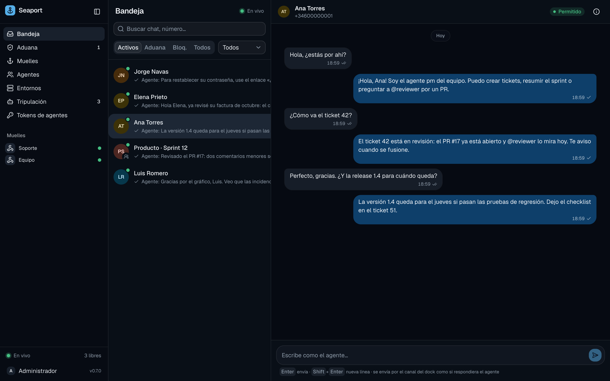

# Your first agent

In this tutorial you put an agent to work on the conversation from [Your first port](first-port.md): you create the agent, assign it to the dock, connect rness (or Claude Code) from your computer, and watch it answer Ana.

## Before you start

- The port from [Your first port](first-port.md), running in `none` mode, with an allowed conversation on an `api` dock.
- An [ACP](https://agentclientprotocol.com) agent on your computer. This tutorial uses [rness](https://github.com/Abraxas-365/rness) with an Anthropic key; [Claude Code](#claude-code-instead) works as well.

## 1. Create an agent and assign it to the dock

An **agent** is a named member of your organization's library: `pm`, `reviewer`, `support`. Its name is also its `@mention` handle. It only receives messages from docks it is assigned to.

```sh
seaport agents add support -description "Answers customer questions"
seaport agents assign support <dock-id> -default
seaport agents
```

`-default` makes `support` take every message on that dock that doesn't `@mention` another agent. In the web app, the agent appears under **Agentes** (Agents) with its dock.

## 2. Connect it

`seaport connect` runs the agent's harness on your machine and bridges it to the port. It dials out over a WebSocket, so the machine needs no public address. Run it from the directory the agent should work in:

```sh
mkdir -p ~/support-agent && cd ~/support-agent
export ANTHROPIC_API_KEY=…                     # the harness's own key; Seaport never sees it
seaport connect -agent support -- rness --acp -m anthropic/claude-sonnet-4-5
```

`-agent support` names the agent in `none` mode. With a token (`token` or `iam` mode) the token names it instead; see [Agents and routing](../guides/agents-and-routing.md#crew-tokens).

The connector logs that it is connected and waits for work.

## 3. Write again as Ana

Ana's first message was held before the agent existed (routing is decided once, when a message arrives). Send a follow-up:

```sh
curl -sS -X POST "http://127.0.0.1:8740/api/v1/docks/$DOCK/ships" \
  -H 'Content-Type: application/json' \
  -d '{"chat_id":"ticket-42","message_id":"m-2","sender_id":"ana","sender_name":"Ana Torres","text":"It is invoice 1043, from October."}'
```

The message is routed to `support` and delivered at once: the connector opens one agent session for the conversation and sends the message as a prompt. The agent can read the earlier message with Seaport's `history` tool, and answers with the `reply` tool.

## 4. Watch the answer

```sh
seaport history <conversation-id>
```

You should see Ana's message and, a few seconds later, an outbound message from `support`, `sent`. The web app shows the answer live in **Bandeja** (Inbox), and **Tripulación** (Crew) shows the connection and the delivery it is working on.



Write again as Ana (a new `message_id`) and the agent continues the same session: it remembers the conversation. Stop the connector with Ctrl-C and start it again; the session is resumed from `sessions.json` in the user configuration directory.

## Claude Code instead

Claude Code speaks ACP through the [claude-agent-acp](https://www.npmjs.com/package/@agentclientprotocol/claude-agent-acp) adapter. It asks permission for each tool, and the connector rejects permission requests unless told otherwise:

```sh
npm i -g @agentclientprotocol/claude-agent-acp
seaport connect -agent support -approve allow -- claude-agent-acp
```

Any other ACP agent works the same way. Agents without HTTP MCP support can't call `reply`; give them `-auto-reply` and the connector sends their final text as the answer.

## Give it instructions

Tell the agent who it is from the port, not from files on your machine. The **profile** is kept in Seaport and applied by whatever connector runs the agent:

```sh
printf 'You answer customers of Acme. Be brief and friendly. Sign as "— Acme support".\n' > instructions.md
seaport agents profile set support -instructions-file instructions.md
```

The running connector notices, finishes what it is working on, restarts the harness with the instructions and resumes its sessions. The next answer is signed. See [Agent profiles](../guides/profiles.md) for skills, MCP servers and secrets.

## If something went wrong

| Symptom | Cause |
| :--- | :--- |
| The connector says the agent is unknown | `-agent` must name an agent of the library (`seaport agents`). |
| The message stays queued | No connection works as the dock's agent; check **Tripulación**. |
| The message is held with "no agent is assigned to this dock" | It arrived before the agent was assigned. Post a new message. |
| The answer appears in the connector's log but not in the chat | The agent didn't call `reply`. Use `-auto-reply` for agents without HTTP MCP. |
| `rness` exits at start | rness needs a model: pass `-m provider/model`. |

## Next

- [Agents and routing](../guides/agents-and-routing.md): several agents on a dock, `@mentions`, crew tokens.
- [The connector](../guides/connector.md): flags, steering, sessions.
- [Hosted agents](../guides/hosting/hosted-agents.md): let the port run the agent for you.
